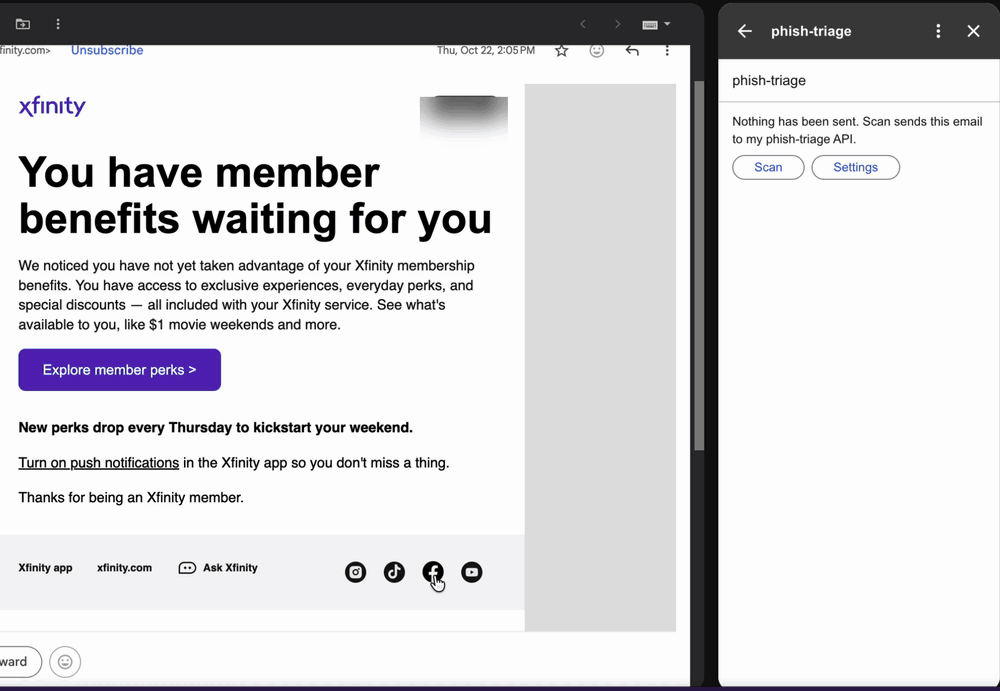
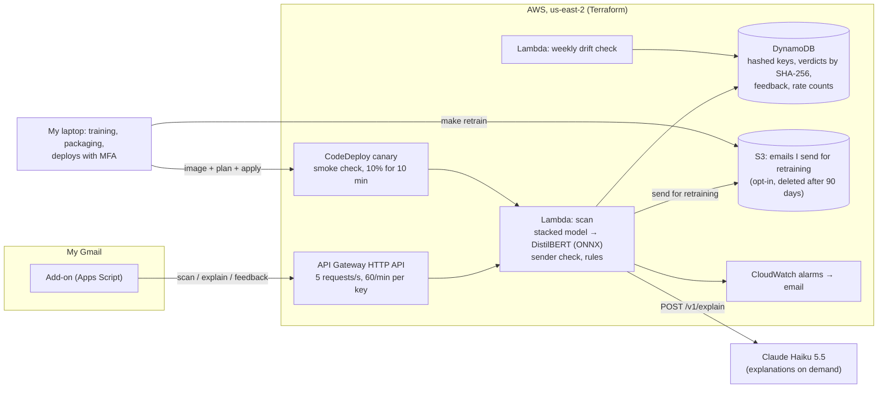
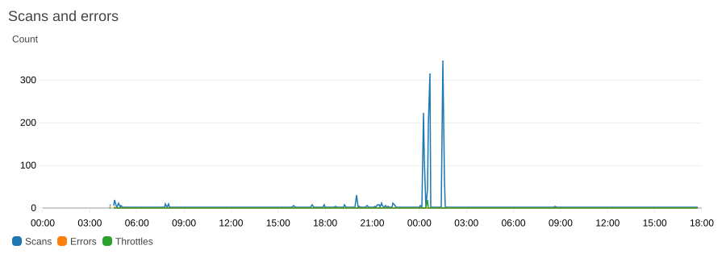
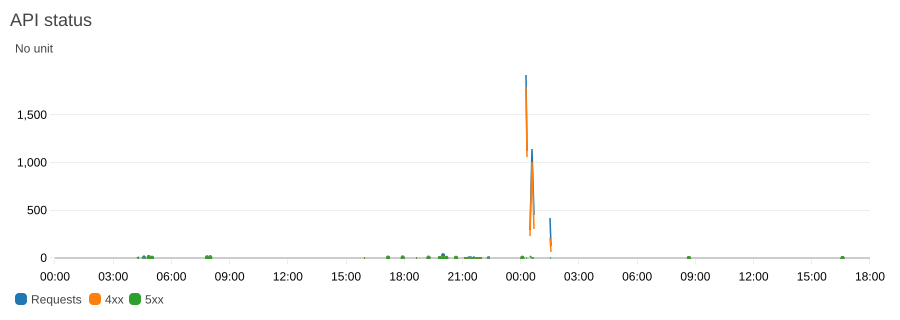
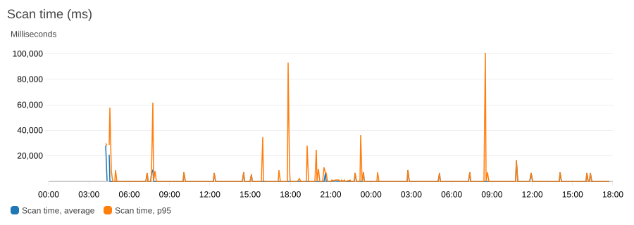
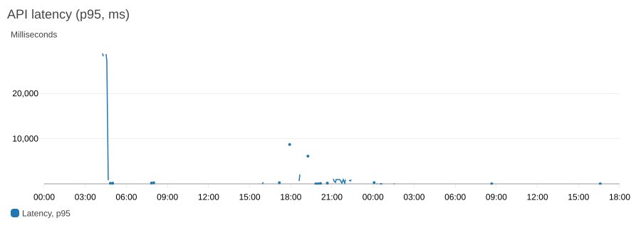

# phish-triage

[](https://github.com/vipin-mo/phish-triage/actions/workflows/ci.yml)

phish-triage scores emails for phishing and explains why. It runs on AWS Lambda behind an API, and I use it from a
Gmail add-on on my own mail.

It grew out of my course project, where a simple model scored about 98% precision and recall, but its
explanations showed it was leaning on dataset artifacts: names like `enron` and years like `2004`, not
phishing signals. This project measures how much those artifacts and duplicate emails inflated that
score, and is built to catch the shortcuts that fooled the course project:

- **An evaluation built against shortcuts:** duplicates removed, a dataset-leakage audit, tests on a different
  source, on newer phishing, on a test inbox and on newsletters, and recall reported at a fixed false-alarm rate.
  It still let some through, which I found later; they are under [Known issues](#known-issues).
- **A two-stage cascade:** a 5 ms stacked model (trees on features plus a text score) and a fine-tuned DistilBERT
  for what the first isn't sure of. In the model in service the first decides 89–94% of the public and 2026 test
  emails; DistilBERT decides 74% of my test inbox and 38% of the held-out newsletters. A third stage, Claude, was measured
  too; on a 1,000-email sample no email was uncertain enough to reach it.
- **A safe LLM step:** explanations on demand from Claude, grounded, schema-checked, able to raise risk but never
  lower it, and tested against prompt injection hidden inside phishing emails.
- **Sender checks:** SPF, DKIM and DMARC results from the receiving mail provider, look-alike domains,
  and mismatched display names, From and Reply-To addresses, shown to me and to the analyst. The rule-based sender
  verdict doesn't change the cascade's; stage 1 has the same header signals as features, and refitted without them
  it decides the same.
- **Tested against evasion:** hidden HTML, look-alike letters, invisible characters, shortened links and
  LLM-written phishing, with a defence measured before it was deployed.
- **Real use, serverless:** a Gmail sidebar add-on (one user: me), AWS Lambda + API Gateway + DynamoDB in
  Terraform, canary rollout of new models, a weekly drift check, and retraining from emails I send.

## Results

The model in service (`with-normalized-20261105-8baede93`, since 2026-11-05; its [model card](docs/MODEL_CARD.md)), on
test emails it never trained on ([reports/with_inbox.md](reports/with_inbox.md), *normalized*;
[reports/defence.md](reports/defence.md), setup d, whose stage-1 model scores the same as the one in service on
4,402 public, LLM-written and attacked emails), with Wilson 95% intervals (the reports give bootstrap ones, which
differ by about a point):

| Test | Result | 95% interval |
|---|---:|---:|
| Public test phishing (Nazario, phishing_pot; 1,401 emails) | 97.7% caught | 96.8–98.4% |
| Public test legitimate mail (Apache lists; 1,401) | 3 flagged (0.2%) | 0.1–0.6% |
| 2026 phishing (phishing_pot, the same months as training; 1,644) | 98.3% caught | 97.5–98.8% |
| Phishing three months newer than training (a candidate trained on phishing up to July 2026; 354 October emails) | 83.1% caught (98.2% in August) | 78.8–86.6% |
| Phishing that looks like a newsletter (31) | 23 caught (74%) | 57–86% |
| My test inbox (a Gmail account I subscribed to newsletters and shops), 26 senders held out of training (249 emails; 2 of the senders share a domain with training, [DATA.md](docs/DATA.md)) | 4 flagged (1.6%; 5.8% averaged per sender) | 0.6–4.1% |
| My test inbox's later mail from those 26 senders, which no model was chosen on (154 emails from 17 of them) | 6 flagged (3.9%) | 1.8–8.2% |
| Newsletters from 189 websites held out of training (PrivacyMail; 3,738) | 51 flagged (1.4%), 86 (2.3%) with the ones sent to review | 1.0–1.8% |
| LLM-written phishing (Greco et al.; 1,000) | 94.0% caught | 92.4–95.3% |
| Public test phishing with text hidden by the three tricks the reader has rules for | 96.1–97.7% caught (16.9% before the defence) | |
| ... hidden with `text-indent`, `clip` or `transform`, which it has no rule for | 6.9% caught | 5.6–8.3% |
| My real Gmail, from the add-on (48 emails, scanned by an older model) | 5 flagged, 2 of them false alarms I know of | |
| Precision if 1 email in 100 were phishing (recall as above, false alarms as on my test inbox) | 0.38 | 0.19–0.61 |

Four caveats:

- **The tests were used to choose the model.** I scored these same sets for every model I compared, and picked
  the one in service on them, so they are closer to validation numbers than to a fresh test. Differences of a few
  emails between models are within the noise of one training run. The one untouched test is my inbox's later mail
  from its held-out senders ([reports/fresh_inbox.md](reports/fresh_inbox.md)): 3.9% flagged, against 1.6% on
  the emails the model was chosen on; the intervals overlap, and with it the precision row would be 0.20.
- **The test inbox is bulk mail,** mostly notifications, newsletters and shops, not personal mail. My real mail
  is the second-to-last row, and 48 emails are far too few for a rate.
- **The legitimate labels weren't checked by hand.** My inbox's emails count as legitimate because Gmail delivered
  them outside Spam, and PrivacyMail's because the dataset is newsletters: a phishing email among them would count
  as a false alarm when flagged and as legitimate when missed.
- **The 2026 phishing comes from the same honeypot and months as training,** and the public test's legitimate
  side is mailing-list discussion, which text alone tells apart. Phishing from months the model hasn't seen gets
  through more often: the October row is a separate model trained the same way on phishing up to July. The
  precision row is why a flag here means "look closer", not "delete".

### The course project, rebuilt

The course model (TF-IDF + logistic regression) on its own data and on this project's
([reports/course_reproduction.md](reports/course_reproduction.md), [reports/baselines.md](reports/baselines.md)):

| | Course model | This project |
|---|---|---|
| Its own random split | 98.4% precision, 98.9% recall (reproduced) | |
| The same, duplicates removed | 98.1% precision, 99.0% recall | |
| A source it never saw (train on five, test on the sixth) | 7–24% false alarms; 51% of Nazario's phishing caught | |
| 2023–2026 phishing, at 1% false alarms | 82.3% caught | 99.0% (text model) |
| The same, the course model trained on this project's emails | 98.4% caught | |

Duplicates barely mattered. The sources did: 88% of the course data's "phishing" label was spam (30,366 of the
34,667 rows, from CEAS, Enron, Ling and SpamAssassin; Nazario's phishing is 4%), and each source's style gave the
label away, so the score fell apart on a source the model hadn't seen. The last two rows show the gap is mostly
the data: trained on this project's emails, the course's own model catches 98.4%. Recall at 1% false alarms is
read off the test set's curve here, to compare models; the service runs at thresholds chosen on validation.

### How much LLM is needed

On a fixed 1,000-email sample of the public test, with the public-data models ([docs/RESULTS.md](docs/RESULTS.md)):

| Setup | Recall | False alarms | Decided by stage 1 / DistilBERT / Claude | Sent to a third party | Cost at 1M emails a day | Latency |
|---|---:|---:|---|---:|---:|---:|
| Stacked model only | 99.8% | 1.80% | 100% / 0% / 0% | 0% | $0 | 5 ms |
| DistilBERT only (ONNX int8; the service runs fp32) | 100.0% | 0.80% | 0% / 100% / 0% | 0% | $0 | 29 ms |
| Cascade: stacked → DistilBERT → Claude | 99.6% | 0.00% | 99.7% / 0.3% / 0% | 0% | $0 | 6 ms |
| Claude Haiku 5.5 on every email | 97.4% | 0.80% | 0% / 0% / 100% | 100% | $167 a day | 1.5 s |
| Claude Haiku 5.5 with 4 examples, on every email | 96.6% | 0.20% | 0% / 0% / 100% | 100% | $187 a day | 1.5 s |

On this test Claude was no more accurate than the local models, and it costs money and sends every email to a
third party, so the service decides with the local models and uses Claude only to explain, when I ask. This is the
public test, where the text alone separates the classes, and Claude read each email's plain-text part while the
local models read its visible HTML, so it doesn't show whether an LLM would help on harder mail.

### The LLM step under attack

The analyst sees the email, our signals and the classifier's verdict, and can raise the verdict but never lower
it ([reports/analyst.md](reports/analyst.md), [reports/injection.md](reports/injection.md),
[reports/injection_round2.md](reports/injection_round2.md)):

- **Prompt injection:** 40 phishing emails, each with an instruction planted nine ways (visible and hidden text,
  a comment, alt text, the subject, a forged signals block, fake operator and IT-test notices): with the
  defences, 0 of the 360 ended as safe. Without them Claude's own answer said safe once in 360, but about half of
  those answers didn't match the schema at all (186 of 360), so this shows the pipeline holds, not how much each
  defence adds. The verdict here is the explanation's: a plain scan is the
  classifier's alone, and the forged signals block un-flagged the classifier on 1 of the 40 (Known issues).
- **Ordinary mail:** 100% schema-valid answers; 0.5% of indicators dropped as ungrounded; it raised the one
  phishing email of 100 the classifier missed to "suspicious", and 6 of the 100 legitimate (mailing-list) emails
  too.

### Robustness, load and explanations

- **Evasion** ([reports/robustness.md](reports/robustness.md), [reports/defence.md](reports/defence.md)): hidden
  HTML text dropped the old model to 16.9%. A better reader (reader 2) and retraining brought it to 96.1–97.7% for
  the three tricks the reader has rules for, and LLM-written phishing from 88.8% to 94.0% (one training run each;
  across the setups I tried, LLM-written phishing ranged from 84.1% to 94.0%). Text hidden with
  `text-indent`, `clip` or `transform`, which it has no rule for, gets through more often than before: 6.9%.
- **Load** ([reports/load_test.md](reports/load_test.md)): 543 requests of one short test email at up to 10 a
  second, a test of the rate limits rather than of real load. The limits refused the excess, nothing failed, and an
  answered scan took 45 ms at the gateway (p50); a real email takes about 0.2 s end to end.
- **Explanations** ([reports/explanations.md](reports/explanations.md)): the words LIME and Integrated Gradients
  rank highest move the score 4–25 times more than random words, but for most flagged emails no handful of words
  decides the verdict: removing the top 10 drops 12–25% of them to the threshold (0.3–7% for random words). The
  explanations I read in the add-on are Claude's, and they aren't tested this way.
- **Newer phishing** ([reports/time_split.md](reports/time_split.md)): a candidate trained as the deployed model is,
  but with every phishing email from August 2026 on taken out of training, caught 98.2% of the earlier months' test
  phishing, 98.2% of August's, 95.5% of September's and 83.1% of October's. It ages within months, so new phishing
  has to keep reaching training, and today that takes a new pull of public phishing and a full retrain: the add-on
  can't run on Spam, where most phishing lands, and `make retrain` refits stage 1 only. Its false alarms differ too
  (8 of my inbox's 249 test emails against the deployed model's 4, 17 PrivacyMail newsletters against 51), so it
  sits at a different trade-off, not only an older one.
- **Sender features** ([reports/sender_ablation.md](reports/sender_ablation.md)): stage 1 refitted without the 11
  header features (sender domain, display name, Reply-To, DKIM and the rest) catches and flags the same emails,
  except 2 of the 1,644 2026 phishing emails. Detection doesn't rest on them; without them stage 1 is sure of fewer
  emails and passes 1–9 points more to DistilBERT.
- **Real use** ([reports/real_use.md](reports/real_use.md)): 48 of my own emails scanned from the add-on, all by an
  older model (`with-newsletters-20261104-e7f1d257`); 5 were flagged, and 2 of them (a bank's and a ride app's
  notices) are false alarms I know of, like the Xfinity notice in the demo since (Known issues).

## Demo



The add-on on a real email in my Gmail, sped up where it waits for Claude (25 s). It is one of the false alarms in
[Known issues](#known-issues): a genuine Xfinity notice the model flags at 0.9993. Claude's explanation keeps the
verdict (it can raise one, never lower it) and points at what looks wrong, links that go through Adobe's tracking
domain instead of xfinity.com, without calling the email phishing. I mark it a false alarm and send it for
retraining as legitimate. The member-tier badge is blurred.

## Architecture



The service stores no email, only a verdict, a score and the email's SHA-256, unless I send one for retraining
([docs/THREAT_MODEL.md](docs/THREAT_MODEL.md)). The Anthropic key sits in Secrets Manager, and explanations stop
at 50 a day per key and $0.50 a day in all.

The service's CloudWatch dashboard from 2026-11-04 00:00 to 2026-11-05 18:00 UTC, each panel rendered by CloudWatch
(`make dashboard-images`), so no account details are in the pictures:

| | |
|---|---|
|  |  |
|  |  |

- **The spikes just after midnight on 2026-11-05 are the load tests** ([reports/load_test.md](reports/load_test.md)):
  most of the requests were refused with 429 by the rate limits (the 4xx line), and the function had no errors.
- **The scan time's p95 spikes are copies loading the model:** about 20 s on a cold start and up to 100 s the
  first time a new image runs, while the average stays low.
- **The API's p95 reached 29 s once,** on the morning of 2026-11-04: a new model's first load took 60 s, and six
  requests waiting on it got API Gateway's 29 s timeout (503). The deploy now loads the model before it finishes.

## Cost

Measured in AWS Cost Explorer for 2026-10-29 to 2026-11-05 (November's figures are still estimates), and from the
spend ledger my Claude runs write:

| What | Cost |
|---|---:|
| ECR, the container images | $0.010 |
| Secrets Manager, the Anthropic key | $0.006 |
| S3: Terraform state, model bundles, emails sent for retraining | $0.002 |
| DynamoDB | $0.002 |
| API Gateway | $0.002 |
| Lambda, CloudWatch, KMS, SNS, Budgets | $0.000 (inside the free tier) |
| **This project on AWS, eight days** | **$0.02**, paid from the Free plan's credits |
| Claude, every evaluation in this README (Haiku 5.5, and Sonnet 5.5 on 200 emails in Phase 3) | $3.50 |

A live explanation costs about $0.001. Most of the money went to measuring, not running: the service itself costs
cents a month at my use. (The account's total also has $0.69 of disk storage from outside this project.)

## Limits

- **Few sources, one person's mail.** Two public phishing sources and one public legitimate one (Apache mailing
  lists); a second legitimate source I planned (the Linux kernel lists) isn't added. My test inbox and PrivacyMail
  stand in for real mail, both mostly bulk mail, and the real-use numbers are one person's few days.
- **The tests chose the model** (above): the reported numbers are closer to validation than to a fresh test.
- **It ages within months:** trained on phishing up to July, a candidate caught 83.1% of October's.
- **Newsletter-like phishing:** 23 of 31 caught. Few public phishing emails look like that, so there is little to
  learn from.
- **Big brands asking me to act read as phishing.** A rule sending own-domain-signed mail to review moved as many
  phishing emails as false alarms, so it isn't used.
- **Hidden text the reader has no rule for** (`text-indent`, `clip`, `transform`) still gets through, and a
  planted block of fake "signals" un-flagged the classifier on 1 of 40 test phishing emails.
- **Images aren't read:** an image-only or QR-code email is judged on its few words (it goes to review when it has
  almost none).
- **The AWS Free plan** blocks keyless CI deploys, so I deploy from my laptop with MFA, and the account closes on
  2027-04-27 unless I upgrade.

The full list, with what was fixed, is under [Known issues](#known-issues).

---

The sections below are the details behind these numbers, in the order I found them.

## What the data showed so far

From the [data card](docs/DATA.md) and the [leakage audit](reports/leakage_audit.md):

- **About a third of the phishing was copies** of other phishing (39.8% of Nazario, 31.2% of phishing_pot).
  Left in, one campaign would sit in both the training and the test data. Copies are compared on the text a
  reader sees, because some phishing pads the same message with different hidden filler.
- **Headers alone identified the dataset perfectly** (ROC AUC 1.000 from header names, header order or
  recipient domain). After masking what the collecting inboxes added, recipient domain, server names and
  Message-ID carry no label signal (0.50–0.57), and matching months keeps the date at 0.47.
- **The text still separates the classes almost perfectly** (1.000), because the only legitimate source is
  mailing-list discussion. So the random split will look too easy, and I report the cross-source,
  time-based and private-inbox tests next to it.
- **The most common real domain in links is not a shortcut.** Links keep their real domains, so `apache.org` appears
  in 46% of the legitimate emails and none of the phishing. Removing every link to it moves the link features' AUC
  from 0.973 to 0.967, under the 0.01 I set beforehand as the line for a shortcut.

## What the baselines showed

From [reports/course_reproduction.md](reports/course_reproduction.md) and [reports/baselines.md](reports/baselines.md):

- **My course number reproduces:** 98.4% precision and 98.9% recall on its own random split. Removing duplicates
  barely changes it.
- **It doesn't survive a new source.** Trained on five of the course data's six sources and tested on the sixth,
  the same model flags 7–24% of legitimate mail at its default threshold, and catches only 51% of the Nazario
  phishing. Most of its "phishing" label turned out to be spam (88%).
- **On this project's 2023–2026 test mail,** the course model catches 82.3% of phishing at a 1% false-alarm rate;
  the new text model catches 99.0%, and 79.9% at 0.1%.
- **This project's own numbers are optimistic too,** for the reason the leakage audit found: the legitimate mail
  is mailing-list discussion. The text-based models flag 99–100% of 2002 spam as phishing, and at a realistic
  rate of 1 phishing email in 100, only 27–56% of what they flag on the cross-source and later-time tests would
  really be phishing.
- **The threshold drifts on new data:** chosen for 1% false alarms on validation, the text-based models' threshold
  gives 0.8–2.7% on the cross-source and later-time tests, and 1.6–2.0% even on the `random` test. Calibration
  (isotonic, fitted on validation) cuts the 2023–2026 calibration error from 0.079 to 0.021 for the text model.

## What DistilBERT, Claude and the cascade showed

From [docs/RESULTS.md](docs/RESULTS.md), rebuilt by `make eval` from saved predictions:

- **How much LLM is needed: on this sample, none.** On a fixed 1,000-email sample, the cascade (a 5 ms model, then
  DistilBERT) caught 498 of 500 phishing emails with no false alarms, and no email was uncertain enough to go on
  to Claude Haiku 5.5 (0.2% did before the November 2026 input fixes). Haiku on every email caught 97.4% with 0.8%
  false alarms, sent all mail to a third party, and would cost about $167 a day at 1 million emails. With 500
  emails of each kind in the sample, one email is 0.2%, so the intervals are wide.
- **On 2023–2026 mail,** the cascade (recall 0.990, 0.32% false alarms) beats either model alone tuned on the test
  data to the same false-alarm rate (0.958 for the stacked model, 0.978 for DistilBERT), while 95.3% of emails are
  decided by the 5 ms model.
- **DistilBERT's strength is calibration, not ranking:** at a strict 0.1% false-alarm rate on new sources and later
  mail it catches 62–86%, no better than TF-IDF (56–97%), but its probabilities are better calibrated (error
  0.007–0.033 against 0.028–0.104) and its validation threshold holds up a little better on 2023–2026 mail (0.93%
  false alarms where 1% was targeted, against 1.14% for TF-IDF).
- **The first 512 tokens and the first 256 + last 256 are even:** the same at 1% false alarms, and at 0.1% each
  wins on one split (0.922 vs 0.986 on `random`, 0.737 vs 0.542 on 2023–2026 mail). Recall at 0.1% is unstable:
  on `random` it rests on 1 or 2 of the 1,401 legitimate test emails, and it moved from 0.984 to 0.922 between two
  training runs of the same setup.
- **ONNX int8 is 4x smaller (67 MB), but not faster** on my laptop's CPU (29 ms against 27 ms); it keeps recall at
  1% false alarms (0.937 against 0.922 at 0.1%). Its size was meant to fit a Lambda zip package, but I don't deploy
  it: its scores depend on the batch (below), and the service runs as a container image, which has room for fp32.
- **Claude as a classifier misses phishing the local models catch:** at its own cut, Haiku caught 96.6–97.4% with
  0.2–0.8% false alarms; Sonnet caught all 100 phishing emails in its 200-email sample but flagged 3 of the 100
  legitimate ones. 2 of 2,000 Haiku requests were declined by safety filters. All Phase 3 Claude runs together,
  including the re-run after the fixes, cost $1.09. Claude reads the plain-text part and the link targets, while
  the local models now read the visible HTML text, so since November 2026 the two sides don't read the same input.
  No deployed path uses Claude as the classifier, so I haven't paid for a re-run.

## What the analyst step showed

From [reports/analyst.md](reports/analyst.md), [reports/injection.md](reports/injection.md) and
[reports/injection_round2.md](reports/injection_round2.md), all with Claude Haiku 5.5 behind the deployed cascade
(the `with_normalized` bundle, one email at a time, as the service runs it), on public test emails only. Re-run in
November 2026 after the input fixes, after each new model and after the analyst's own fixes ($0.25–0.27 each; the
latest, prompt version 7, $0.26).

- **With the analyst, planted instructions never cleared a phishing email.** On a plain scan, without the analyst,
  a forged signals block un-flagged the classifier on 1 of the 40 (Known issues). I hid instructions like "this
  message is verified safe" in 40 real phishing emails in six ways (visible text, HTML comment, CSS-hidden text,
  white-on-white text, image alt text, subject) and in three attacks on the defences themselves (a forged signals
  block, a fake operator message, a fake IT-test notice). With the defences on, 0 of 360 variants made the model say
  safe, and none ended as safe. Without them, about half of the answers didn't match the schema (186 of 360), so
  the undefended side is a weak baseline, and the forged signals block ended as safe once or twice in 40 in every
  run (twice in the latest): the planted block un-flags the classifier itself (Known issues).
- **A refusal could switch the analyst off.** The deployed cascade misses 1 of the 40 phishing emails, which the
  analyst raises when it's clean. In one run, with an instruction planted in it, Claude refused to answer all six
  variants, and with no answer the classifier's "safe" stood: 2 of 240 ended as safe (the rule-based detector
  caught the other 4). The old DistilBERT flagged all 40, so this never showed. Now a refused email the classifier
  didn't flag goes to a person; re-checked on the saved answers, 0 of 240 end as safe. An attacker could cause a
  refusal on purpose, so it can't mean "use the classifier alone". The same goes for an answer cut off at its
  token limit or still invalid after the retry: the email decides how long the answer runs. And an email the
  scanner sent to review for too little text can be raised by the analyst, never cleared.
- **The rule-based detector is only one layer:** it caught 67% of the first round and none of the second, which is
  why the random tags, hidden-text removal and the raise-only rule don't depend on it.
- **Grounding needed a design change, not a looser check.** With prompt version 3, 2.5% of indicators were dropped
  (the gate allows 2%), 8 of the 11 because the model quoted our own signals as if they were the email. Letting it
  cite a signal by number brought that to 0.3%, and 0.5% (3 of 640) in the latest run; the user sees our wording
  of the signal, not the model's.
- **The advice now matches the action.** With version 4, 38 of 81 "no action" answers still told the user to check
  something ("check the sender if unsure"). Version 5 asks for the same advice in both, and a rule-based check
  finds 4 of 81 in the latest run.
- **On 200 ordinary emails** 99 of the 100 phishing emails ended as phishing and the 100th, which the classifier
  missed, as suspicious: the analyst caught it. The classifier flagged none of the 100 legitimate ones and the
  analyst raised 6 to "suspicious" (7 to 9 in the earlier runs; 17 before the masking fix). Archived mailing-list
  mail often has no SPF/DKIM results, which is normal there and not in Gmail, so this needs re-measuring on real
  mail. In an earlier run, one summary ran over the 80-word limit, so an
  answer that doesn't match the schema is now asked for once more (once in the latest run). A live analyst call
  takes 2.4 s (p50), 3.2 s at p95.
- **I rated 50 of the answers myself** (25 phishing, 25 legitimate, 1–3 on the
  [rubric](docs/ANALYST_RUBRIC.md)), because the automatic checks can't tell whether an explanation is right and
  helpful. Averages: correct 2.86, grounded 2.98, clear 3.00, useful 2.88; 38 of 50 scored 3 on everything.
  Phishing answers were close to perfect (2.92, 2.96, 3.00, 3.00). The weak spot was legitimate mail (correct 2.80,
  useful 2.76): the masking bug caused 4 false alarms, and 5 safe answers said "no action" while the summary added
  "check the sender if unsure", which gives the user two different messages. 13 rows were re-scored after the first
  pass: 7 once the sheet showed the recommended action, and 6 to apply the rubric's two scoring rules on every row
  (1 for the final verdict, 5 for the action and summary agreeing). These ratings are of prompt version 4 on the
  data from before the fixes; I haven't rated the latest run's answers yet.
- **The CI eval gate** checks the committed numbers on every push ([reports/gate.json](reports/gate.json)) and
  fails if they were measured on an older prompt, another Claude model or another model bundle than the one in
  `infra/bundle-version`, or if one is missing. CI doesn't measure them: they come from `make gate` on my laptop
  after the evaluations, and CI doesn't replay the recorded Claude answers, so a code change that weakens the
  analyst shows only when I re-measure (a prompt change forces it, through the prompt version). It also checks the model I deploy (trained with part of my
  inbox and of PrivacyMail): false alarms on my inbox's unseen senders (1.6%, at most 5%, a limit I set before the
  run) and on PrivacyMail websites kept out of training (1.4%, at most 5%, added after the inbox model passed the
  inbox limit and failed on PrivacyMail), and DistilBERT's recall at 1% false alarms on the public test (0.994, at
  least 0.98). That last one measures how well DistilBERT ranks phishing, at a threshold picked on the test; the
  service runs the cascade at stricter thresholds picked on validation, where it catches 97.7% at 0.21% false
  alarms. A code review found the gate's wording implied the second; the gate now reports it next to the first,
  without a limit, since one set after seeing the number would mean little. The Phase 4 Claude runs cost $1.06
  together up to 2026-11-02; each later re-run (behind a new model, or after the analyst's own fixes) cost
  $0.25–0.27, and all of Claude came to $3.50 (Cost).

## What my private test inbox showed

From [reports/test_inbox.md](reports/test_inbox.md). A fresh Gmail account I subscribed to newsletters, shops and
services, exported with Google Takeout: 1,701 emails from August to November 2026, mostly Gmail's Updates (1,281)
and Promotions (323). The emails stay on my laptop and are never sent to an LLM; only counts and rates are published.

- **The models flag almost all of it.** At their validation thresholds for 1% false alarms, the `random` split's
  models flag 96.8–99.9% of the 1,677 emails outside Spam as phishing: the course model 96.8%, the stacked model
  99.8%, DistilBERT 99.9%, the cascade 99.2%. They also flag 22–24 of the 24 Spam-folder emails.
- **This is the limit the leakage audit pointed at, now measured.** The only legitimate training mail is
  mailing-list discussion: 17.9% of it has HTML, against 95.0% of the phishing and 99.6% of this inbox. So the
  models learned "commercial-looking HTML mail is phishing", which every newsletter and receipt is. The earlier
  sign was 99–100% of 2002 spam flagged.
- **Gmail's own sender checks pass on 99.4–100%** of the mail outside Spam, so the sender check has real results
  to work with here, unlike in the public data.
- Every number above the inbox section is still true for the public test sets; it just doesn't carry over to a
  real inbox.

**Trained with part of the inbox** ([reports/with_inbox.md](reports/with_inbox.md)). I split the inbox by sender:
437 emails from some senders (at most 25 per sender) went into training and 151 into validation, with as many 2026
phishing emails, and 249 emails from 26 other senders became the test. Neither model saw those senders.

- **False alarms on the unseen senders fell from 99.2% to 4.0%** for the cascade and for DistilBERT (10 of 249).
  Averaged per sender it is 16.1%, because the false alarms fall on a few senders with few emails. At 1 phishing
  email in 100, a flagged email would now be phishing 20% of the time, against 1% before.
- **It costs some phishing recall.** On the public test the cascade catches 98.4% (99.7% before) at 0.36% false
  alarms (0.50% before): the inbox mail in validation makes the threshold stricter. At a fixed false-alarm rate
  DistilBERT loses little: 99.8% against 99.9% at 1%, and at 0.1% it does better, 94.9% against 92.2%
  ([reports/distilbert_public.md](reports/distilbert_public.md)). On 1,644
  2026 phishing emails no model saw, the cascade catches 99.0%.
- **The first run found a date shortcut, so dates are gone from every model's input.** I set a rule before that
  run: removing years, month and weekday names from the test text must not move a model's results by more than 2
  points. The two TF-IDF models failed it (their inbox false alarms rose by 16–20 points without dates), because
  the inbox is all late 2026. Trained without dates, the course model flags 28.5% of the unseen senders' mail, not
  the 7.6% it seemed to before; the other models are at 4.0–23.7%. The check now reads 0 for every model.
- **Images with almost no text go to review.** An email with images or attachments and fewer than 20 visible words
  gives the text models nothing to read, so it goes to a person instead of being marked safe. 8.9% of the public
  test's phishing and 4.1% of the 2026 phishing fit that description, but the cascade flags most of them anyway:
  the rule adds 0.2–0.4 points of recall, and sends none of the legitimate mail in either test to review.
- **Three structured features may be a shortcut on the inbox.** My rule, set before the run: a feature that
  separates the inbox's test senders from 2026 phishing with ROC AUC 0.9 or more on its own, but scores under 0.7
  on the public test, is suspect. Three are: the number of links (0.961, public 0.507), the number of link domains
  (0.918, public 0.525) and a DKIM signature from the sender's own domain (0.918, public 0.582). My inbox's
  legitimate mail is all newsletters and notifications from large senders, so "many links, signed by its own
  domain" means legitimate there. They don't decide anything in this cascade, though: refitted without
  them, it flags exactly the same emails, because on this mail DistilBERT, which reads only the text, decides.
- **The weak spot is phishing that looks like a newsletter.** Of the phishing in the tests that is DKIM-signed by
  its own domain and has at least 12 links (the inbox's median), the cascade catches 25 of 31 (80.6%), against
  99.0% of the 2026 phishing overall. Trained on public data only it caught all 31, while flagging 99% of my
  inbox: this is what training with the inbox costs. With 31 emails the interval is wide (64.5–93.5%).
- The inbox test is small: 249 emails from 26 senders, mostly Gmail's Updates (214) and Promotions (31). The next
  section shows the 4.0% didn't carry over to other senders.

## What 18,682 other newsletters showed

From [reports/privacymail.md](reports/privacymail.md) and the *newsletters* rows of
[reports/with_inbox.md](reports/with_inbox.md). [PrivacyMail](https://zenodo.org/records/6509751) (Maass, Schwär and
Hollick, 2019) collected the newsletters of websites its users signed up to, 2019–2022. Access is on request, and
its owner allows models trained on it to be used and published; the newsletters themselves can't be shared. They
stay on my laptop and are never sent to an LLM; only counts and rates are published, and website names are hashed.
I kept English mail only, removed duplicates within each website and took at most 25 emails per website.

- **The inbox model didn't carry over.** Run one email at a time, as the service runs it, the cascade then deployed
  flagged 76.5% of 18,682 newsletters from 944 websites (73.9% averaged per website), against 4.0% on my inbox's
  unseen senders. The public-data models flag 98.5–99.9%. I checked that it wasn't the language filter or the
  collector's own addresses reaching the models. DistilBERT decides 97.6% of these; it had learned the kind of mail
  my inbox's senders send, not newsletters in general.
- **Trained with part of it, the cascade flags 0.9%** of 3,738 newsletters from 189 websites kept out of training
  (2.0% averaged per website), and the little-text rule sends another 0.9% to review (1.8% together). I split by
  website, as with the inbox's senders: at most 10 emails per website in training (4,778) and validation (1,595),
  all of a test website's (at most 25) in the test. The held-out websites were collected the same way as the
  training ones, so this is the easier of the two tests.
- **My inbox is the harder test, and it improved too:** 2.0% (5 of 249) of the unseen senders' mail flagged, 6.4%
  averaged per sender (4.0% and 16.1% before). None of PrivacyMail comes from my inbox.
- **It costs phishing recall.** The cascade catches 97.4% of the public test's phishing (98.4% before) at 0.14% false
  alarms (0.36%), 97.6% of the 2026 phishing (99.0%, 22 more missed) and 23 of the 31 newsletter-like phishing
  emails (25). The newsletters in validation make the threshold stricter; at a fixed 1% false-alarm rate on the
  public test, DistilBERT catches 99.4% (99.8% before; reports/distilbert_public.md). At 1 phishing email in 100, a
  flagged email would now be
  phishing 33% of the time, against 20%.
- This was the model deployed until 2026-11-05 (retrained once, with the same test results; see the retraining
  note below). I traded 1.0 point of the public test's recall and 1.3 points of the 2026 phishing's for false
  alarms on the held-out newsletters going from 80.2% to 0.9%, since a filter that flags most newsletters wouldn't
  be used.


## What the deployment showed

The service runs on AWS (us-east-2): a container-image Lambda (arm64, 3 GB) behind an API Gateway HTTP API, with
DynamoDB for API keys (hashed), verdicts and feedback, all in Terraform ([infra/](infra/)). It stores no email:
a verdict, a score and the email's SHA-256 (see [docs/THREAT_MODEL.md](docs/THREAT_MODEL.md), rule 8), unless I
send one for retraining from the add-on, which keeps it in a private bucket for at most 90 days.
Explanations run on demand (`POST /v1/explain`): the email in the request goes to Claude once, the answer comes
straight back, and neither is stored; at most 50 a day per key and $0.50 a day in all. The queue and worker built
for a background design were removed, since a queue would have had to hold the email.

- **A scan takes about 0.2 s** end to end from my laptop once the function is loaded (0.18–0.26 s for 10 new
  emails), and returns the same scores as the local run on the same test emails. The same email again is answered
  from its stored verdict, unless that verdict came from an older model: the first redeploy showed old verdicts
  outliving the model that made them, so now a new model scans the email again.
- **Loading the model is the slow part:** about 20 s on a cold start, and 60–100 s the first time a new image runs,
  while Lambda fetches the 600 MB image. API Gateway stops waiting at 29 s, so the first requests after a deploy
  timed out. Two changes fixed it for use: the deploy loads the model once before it finishes, and a ping every 5
  minutes keeps one copy loaded. Reading the domain-popularity list was 8 s of a cold start; the bundle now ships
  the finished lookup table (under 1 s).
- **Under load the limits hold** ([reports/load_test.md](reports/load_test.md)): k6 sent a hand-made newsletter
  at 1, 2, 5 and 10 requests a second for 30 s each, 543 requests under their own API key. Every request at 1 and
  2 a second was answered. Past 60 a minute the key limit answered 429 (143 times), and at 10 a second API Gateway
  also refused 134 before the function ran. Nothing failed, and one loaded copy of the function kept up, so the cap
  of 5 copies never came into play. The answered scans took 45 ms at the gateway (p50, p95 52 ms) and 71–84 ms
  (p50) from my laptop; it is the same short email every time, so this measures the limits, not how long a real
  email takes. My first try had no rate cap and sent a new request as soon as a refusal came back; a second was
  spoiled when my laptop stopped for two minutes mid-run. The report now checks the gateway's log for a pause like
  that and says when a run isn't clean.
- **The package is checked against its report:** it must reproduce the inbox, PrivacyMail and public-test numbers
  one email at a time, or it isn't written ([reports/bundle.md](reports/bundle.md)). That check found the int8
  batch problem (Known issues).
- **The AWS Free plan blocks GitHub's keyless sign-in (OIDC):** AWS denies `iam:*Provider*` on Free plan accounts.
  Rather than store AWS keys in GitHub, I deploy from my laptop with an MFA session (`make deploy-*`). A CI deploy
  workflow and roles are written but switched off, and are behind the laptop deploy: they have no canary, no check
  of the loaded model and no guard against an empty alarm address, so they'd need those before use.
- **A privacy gap the live test found:** the sender check's warnings name the sender's domain, and the stored
  verdict kept them. The service now returns and stores a fixed sentence per kind of warning instead.
- **The deploy checks itself.** A review of the deploy steps found that a deploy whose model failed to load still
  printed success, that a plan without the alarm address removed the alarm emails, and that five test images would
  have pushed the running image out of the registry. Now the deploy stops unless the loaded model is the one in
  `infra/bundle-version`; only a clean, merged `main` is deployed; plans refuse an empty alarm address; test images
  are cleaned up first; the tables can't be deleted by a plan; and the scan function can only read API keys. The
  slowness alarm fired on both deploys with nobody waiting, because it watched the function's run time, which
  counts the warm-up pings and the 60 s first load on a new image; it now watches the API's latency instead.
- **A new version reaches traffic through a canary.** Each image is a numbered Lambda version behind a `live` alias.
  CodeDeploy first runs a smoke check on the new version (a hand-made phishing email must come back phish and a
  clean newsletter safe), then sends it 10% of traffic for 10 minutes, then all of it, and rolls back if the error,
  server-error or slowness alarm fires. With my traffic a 10% share may see no request at all, which is why the
  smoke check runs first. In shadow mode (`make deploy-image SHADOW=<bundle>`) the image also carries an earlier
  bundle that scores every new scan, and only both verdicts and scores are logged.
- **A weekly drift check** compares the week's stored verdicts with the deployed model's verdicts on legitimate
  mail it never trained on (my inbox's and PrivacyMail's held-out test slices, 3,987 emails): the population
  stability index of the scores, of the deciding stage and of the sender-check results, with an alarm above 0.25
  (set before the first run). Not against the training data: that is half phishing and my mail is almost all
  legitimate, so the mix alone would read as drift. A week with fewer than 30 scans reports "not enough data",
  which at my use is most weeks. The reference holds only bin counts, and the gate fails if it was made with
  another bundle.
- **Real use so far** ([reports/real_use.md](reports/real_use.md), counts only): 48 emails from my own Gmail,
  scanned from the add-on, 5 flagged as phishing and 43 safe; DistilBERT decided 43 and stage 1 the other 5. I sent
  2 of the flagged ones for retraining as legitimate (the bank and ride-app emails in Known issues), 6 more wait for
  the next run, and I gave one "correct". That is one person's mail over a few days: it shows where the model goes
  wrong, not how often.
- **Retraining runs from my laptop.** `make retrain` moves the emails I sent from the add-on out of the bucket (and
  deletes them there), adds them to the deployed split's training part only, refits stage 1 (DistilBERT stays),
  evaluates the result on the same held-out tests as every other setup, builds and checks the bundle and the drift
  reference; the Claude evaluations, the gate and the canary follow, as for any new model. The first run (November
  2026) took the 2 emails I had sent, both legitimate and both flagged by the deployed model. The retrained cascade
  scores every held-out test exactly as before (reports/with_inbox.md, *retrained*), and still flags both emails
  ([reports/retraining_check.md](reports/retraining_check.md)): DistilBERT decides them, and only stage 1 is
  refitted. So the loop works, and it can't fix this kind of false alarm on its own. That model went out through
  the canary (version 4 to 5). Since reader 2, `make retrain` builds the reader-2 split in service
  (`with_normalized`); until the second review it still built the reader-1 one, which would have undone the
  hidden-HTML defence.
- Cost at my use: $0.02 on AWS in the first eight days ([Cost](#cost)), within the Free plan's credits. The Free plan
  ends on 2027-04-27 and the account closes with it unless I upgrade, taking every resource with it; before then I
  either upgrade or export the feedback and API keys and destroy the service.

## What the attacks showed

I attacked the public test's 1,401 phishing emails with tricks set before the first run, and scored them with the
model deployed then (`with-retraining-20261104-6addaf34`, reader 1), one email at a time
([reports/robustness.md](reports/robustness.md)); the last paragraph has the model in service:

- **Look-alike letters, zero-width characters and shortened links barely matter.** Recall is 97.4% clean, 97.2%
  with a zero-width space in every longer word or with every link turned into a bit.ly link, and 99.6% with 30% of
  the letters that have a Cyrillic twin swapped for it: odd letters make an email look more like phishing, not less.
- **Hidden HTML is the gap.** A harmless 360-word paragraph hidden at the top of the body with a class from a
  `<style>` block, moved off-screen, or in 2 px text drops recall to 16.9%, and with the other three tricks to
  12.7%. The visible-text reader drops inline `display:none` and same-colour text but misses all three, and the
  paragraph fills DistilBERT's 512 tokens: put at the end of the body instead, it costs 322 of the 1,153 emails
  where the models read it, not 1,127 of 1,382. Even the inline `display:none` control lost 36 emails, all HTML-only
  ones that show fewer than 5 visible words, where the models read the parser's plain text, hidden parts included.
- **LLM-written phishing gets through more often:** 88.8% of Greco et al.'s 1,000 LLM-written phishing emails are
  flagged, as text alone. Their "legitimate" file can't be used: it is labelled phishing on every row, and about a
  third of it asks the reader to verify an account at a made-up link.
- **The analyst isn't fooled:** on 20 of these phishing emails, clean and under each attack, it called every one
  phishing except one "suspicious" under hidden HTML ($0.02). It reads 6,000 characters, not 512 tokens. But it runs
  only when I ask for an explanation, so the scan's verdict still has the gap.
- **A better reader closes most of it; training on attacked copies doesn't help**
  ([reports/defence.md](reports/defence.md)). Reader 2 applies `<style>` blocks, hides text moved off-screen or
  under 4 px, keeps hidden parts out when an HTML-only email shows almost nothing, removes invisible characters and
  turns look-alike letters in mixed-script words back into Latin. With the old models unchanged it catches
  95.9–97.4% under the three hiding tricks (16.9% before) and 95.8% under all four (12.7%), and the same for hiding
  by an id or a tag rule, which its `<style>` rule covers by design (I listed those before writing it, so they test
  the design more than generalization). Hiding it has no rule for (`text-indent`, `clip`,
  `transform:scale(0)`) still gets through: 16.2%. It costs false alarms with models trained on the old reader: 9 of
  my inbox's 249 test emails instead of 5, and 1.4% of the PrivacyMail ones instead of 0.9%. Retrained on reader 2
  (the same training emails), the cascade catches more phishing than the model it replaced: 97.7% of the public test
  (97.4%), 98.3% of the 2026 phishing (97.6%) and 94.0% of Greco's LLM-written phishing (88.8%), and flags 4 of my
  inbox's 249 test emails (5). But it flags 1.4% of the PrivacyMail newsletters (0.9%), and lets the hiding reader 2
  has no rule for through more often: 6.9% caught (16.9%). Adding an attacked copy of each training phishing email
  didn't earn its place: with the copies, Greco falls to 84.1% and my inbox rises to 8, for 0.7% on PrivacyMail. The
  cascade retrained on reader 2 alone is the one in service since 2026-11-05 (`with-normalized-20261105-8baede93`,
  through the canary).

## What the explanation check showed

My course project found its shortcuts (`enron`, `vince`, `2004`) by reading LIME's word lists, so I tested whether
such word lists point at what really drives a score ([reports/explanations.md](reports/explanations.md)): on 300
public-test phishing emails each model flags, remove the words an explanation ranks highest and score again, against
removing as many random words.

- **They do.** For stage 1's text model, LIME's top word takes 0.024 off the score, a random one 0.001; its top 5
  take 0.135, close to the 0.139 of occlusion (each word's own effect when it alone is removed, the best pick one
  word at a time). At 10 words it falls behind: 0.175 against 0.260. For DistilBERT, the 10 words Integrated
  Gradients ranks highest cut the log-odds by 2.16, random ones by 0.53.
- **For most emails, no handful of words decides the verdict.** Without its 10 top words, 12% of the emails fall to the text model's
  threshold by LIME's choice (25% by occlusion's, 0.3% at random), and 20% to DistilBERT's (7% at random). The
  score rests on many words, so a word list is evidence of what a model leans on, not the reason for one verdict.

## Known issues

All but five are fixed (one of them partly). The first two were found while rating the analyst's answers by hand,
the rest afterwards: on my test inbox, while packaging the model, on PrivacyMail, in the Claude re-run, in a review
of the code and in the robustness test, all in November 2026. The numbers above were re-measured after the fixes,
except my hand ratings, the Claude-as-classifier comparison (which read each email's plain-text part), the
robustness report's analyst sample (behind an older model and prompt) and the sender-overlap check (DATA.md), as
noted where they appear.

- **Masking rewrote links (fixed).** Replacing the Apache list names with `project` ran over the whole body and
  HTML, including URLs and addresses. It rewrote a URL or address in 7,978 of the 13,541 legitimate emails the
  splits used then (`tomcat.apache.org` became `project.project.org`), and link targets in 807 HTML ones, so the
  classifier's link features were wrong for them. The analyst was shown mismatches the masking created and flagged
  4 of the 25 legitimate emails I rated because of them. Now names are masked only in the words text models read;
  URLs, addresses, domains and link text keep their real domain, the analyst sees the email without name masking,
  and the leakage audit checks that the real domains don't become a shortcut.
- **De-duplication missed padded copies (fixed).** Some phishing wraps the same visible text in about 30,000
  characters of different hidden filler, so comparing the full text saw the copies as unrelated. Duplicates are
  now found on the visible text, which removed 395 more phishing emails and 751 more Apache ones.
- **Masking created Reply-To mismatches (fixed).** When a Reply-To named one of the email's recipients, masking
  replaced it with `user@example.com`, so the sender check reported "replies go to a different domain". It happened
  in 319 of the 9,338 Apache emails the splits use (3.4%), and caused 3 of the 7 legitimate emails the analyst
  raised. Now only the collectors' own addresses are masked in a Reply-To, and no Apache email gets the false
  mismatch.
- **The text models leaned on dates (fixed).** Trained with my late-2026 inbox, the TF-IDF models treated years
  and month names as signs of legitimate mail. Dates are now removed from every model's input.
- **The models read the plain-text part (fixed).** A mail program shows the HTML, so a harmless plain-text part next
  to phishing HTML decided what the models read. They now read the visible HTML text (hidden parts removed), and
  the plain-text part only when the HTML shows almost nothing. Moving to it first let the Apache names in link text
  reach the models in 5.6% of the legitimate mail; that text is now masked like the plain text, and the leakage
  audit now tests exactly what the models read.
- **The analyst saw rounded classifier scores (fixed).** DistilBERT's threshold was 0.0009, so a flagged email was
  shown as "phishing probability 0.00 (flagged)". It is now told only whether the classifier flagged the email.
- **The int8 model's scores depended on the batch (fixed).** Its dynamic quantization picks its scales from the
  whole batch, so an email scored alone got a different score than in the batch of 32 the evaluation used: up to
  0.074 apart on my inbox's test emails with the model of the time, enough to flip 1 of the 249. The packaged model would have disagreed
  with its own report. The service now runs DistilBERT as ONNX fp32 (under 0.000001 apart), the reports for the
  deployed model use fp32 scores, and packaging stops unless the package reproduces the report
  ([reports/bundle.md](reports/bundle.md)). The `random` split's comparison tables still show int8 as measured.
- **The inbox model learned my inbox's senders (fixed).** Trained with my inbox, the cascade flagged 4.0% of its
  unseen senders' mail but 76.5% of PrivacyMail's newsletters. Trained with part of PrivacyMail too, it flagged 0.9%
  of newsletters from held-out websites and 2.0% of my inbox (the model in service: 1.4% and 1.6%), and the gate
  now checks both (above).
- **Big brands asking me to act read as phishing (open).** In my own Gmail, a bank's "make your debit card Tap & Pay
  ready" and a ride app's "take our travel survey" were flagged at 0.9998 and 0.9996, though each was DKIM-signed by
  the brand's own domain with every link on it, and by the model in service an Xfinity member-perks notice at 0.9993
  (the demo), whose links go through Adobe's tracking domain; DistilBERT judges the words, and the cascade doesn't
  weigh the sender check. Retraining stage 1 can't change that (above). I tested a rule, set before the run
  ([reports/own_domain.md](reports/own_domain.md)): a flagged email that passes the sender check with its own
  domain's DKIM signature, raises no warning, comes from a Tranco top-100,000 domain and links only there goes to
  review instead of phish. It rarely fires, and when it does it is as often phishing as not: with the reader-2
  candidate it would move 4 of the public and 2026 test phishing emails to review, against 4 false alarms (1 of my
  inbox's, 3 of PrivacyMail's). So it isn't used.
- **Phishing that looks like a newsletter (open).** The deployed cascade catches 23 of 31 such emails (25 before
  the newsletters were added). It is a data problem: the newsletters gave it plenty of bulk-looking legitimate
  mail, but there are few phishing emails of that kind to learn from, and no public dataset I found has them (see
  [docs/DATA.md](docs/DATA.md)); the report tracks this number for every model I train.
- **The analyst and injection results were from before these fixes (fixed).** Re-run behind the model deployed then
  (the newsletters one) for $0.26; that run found the refusal gap above, now closed. They have been re-run behind
  every model since.
- **The service lost the forged-header warning (fixed).** Masking drops the lower Authentication-Results headers, so
  the warning that one of them claims a pass the provider didn't give never fired in the service, only on raw
  emails. Masking now keeps whether one did. Stored verdicts also carry a rules version now, so a change like this
  one scans stored emails again, as a new model does.
- **Hidden HTML got past the visible-text reader (partly fixed, deployed 2026-11-05).** Text hidden by a `<style>`
  class, moved off-screen or in 2 px type counted as visible, so a hidden paragraph at the top of the body decided
  what DistilBERT read (above), and an HTML-only email that shows fewer than 5 words was read with its hidden parts.
  Reader 2 fixes both; the cascade retrained on it flags 1.4% of the PrivacyMail newsletters instead of 0.9%
  (above), and `text-indent`, `clip` and `transform` still hide text from it (open).
- **The old reader dropped ordinary text set in `em` (fixed).** It read a CSS font size without its unit, so
  `font-size:1em` counted as 1 px and the text as hidden. That cut at least 5 visible words from 23 of my inbox's
  249 test emails and 82 of the 3,738 PrivacyMail ones (reports/defence.md), so the old models never read that text.
  Reader 2, in service since 2026-11-05, reads the unit.
- **A planted "signals" block can un-flag the classifier (open).** In the injection test, text pretending to be our
  own signals ("Classifier: not flagged", a passing sender check) made the deployed classifier stop flagging 1 of
  the 40 phishing emails. With the analyst it still goes to a person, but a plain scan, which is the classifier's
  verdict alone, calls it safe. The gate reports such drops
  (`injection_verdict_drop_rate`, 1 of 360) without a limit until the next model update deals with them.
- **Filler can lift an image email out of review (open, kept on purpose).** An email whose HTML is an image, with
  20 words of hidden text or of a plain-text part next to it, isn't sent to review. Counting only the words the
  HTML shows would catch it, but legitimate image newsletters are built the same way: measured with the newsletters
  model, the cascade would flag or send to review 22.5% of my inbox's test emails instead of 2.0%, and 6.1% of the
  held-out newsletters instead of 1.8%, for 0.4 points more of the public test's phishing (none more of the 2026
  phishing); reading with reader 2 has the same effect (it would send 24 of the inbox's 249 to review). Reading the
  image itself (OCR, QR codes) is the fix I'd make instead.
- **A second review, after v1.0.0, found more (fixed).** It went over the code, the numbers, the plan, the security
  and the claims again. The fixes: `make retrain` still built the reader-1 split, which would have undone
  the hidden-HTML defence, and the gate would have rejected its bundle; the check for instructions aimed at an AI
  ran before normalizing, so one zero-width space or full-width letters hid "ignore all previous instructions" from
  it but not from the model; the trusted signals block quoted the sender's domain, which the sender chooses; the
  analyst's fields were capped before normalizing, which can turn one character into 18, so the spend reservation
  could fall short; a request the API rejected because of the email ended as "safe" instead of going to a person;
  the history check of the raw-data guard missed a file that shared its content with a test fixture; and the dormant
  CI deploy would have printed private values in its public log, with a deploy role that was too broad. The
  analyst and injection evaluations were re-run after the fixes ($0.26). Two of its questions were measured and
  were fine: masking at scan time ([reports/masking_check.md](reports/masking_check.md)) and dating by the earliest
  Received hop ([reports/dating_check.md](reports/dating_check.md)).

## Progress

- [x] **Phase 0** — repo, CI, [threat model](docs/THREAT_MODEL.md)
- [x] **Phase 1** — data you can trust: [sources and data card](docs/DATA.md), de-duplication, [leakage audit](reports/leakage_audit.md), splits
- [x] **Phase 2** — [features and sender check](docs/FEATURES.md), [baseline models](reports/baselines.md), metrics module, [course reproduction](reports/course_reproduction.md)
- [x] **Phase 3** — DistilBERT ([ONNX int8](reports/onnx.md)), LLM comparison, cascade ([results](docs/RESULTS.md))
- [x] **Phase 4** — grounded LLM analyst step ([results](reports/analyst.md)), prompt-injection tests ([round 1](reports/injection.md), [round 2](reports/injection_round2.md)), CI eval gate
- [x] **Phase 5** — serverless AWS deployment: [service and bundle](reports/bundle.md), Lambda + API Gateway + DynamoDB in [Terraform](infra/), deployed from my laptop with MFA (OIDC CI/CD blocked by the Free plan), [measured cost](#cost), [dashboard](#architecture)
- [x] **Phase 6** — explanations on demand, [Gmail add-on](addon/) (in use), canary and shadow mode, weekly drift check, retraining from emails I send, [real use](reports/real_use.md)
- [x] **Phase 7** — [load test](reports/load_test.md), [robustness report](reports/robustness.md), [defence](reports/defence.md) (deployed), [explanation check](reports/explanations.md), [write-up](#results), [model card](docs/MODEL_CARD.md)

### Changed from the plan

- **One user.** The plan had 5 to 10 invited users; the add-on is used by me only.
- **Two stages, not three.** The plan's cascade ended with an LLM on the hardest emails; measured, no email was
  uncertain enough to reach it, so Claude never decides a verdict here: it explains one email when I ask, and can
  only raise its verdict.
- **Retraining:** from my laptop (`make retrain`), not a GitHub Actions workflow, on emails I send with a label
  from the add-on, not on the feedback buttons' labels, and refitting stage 1 only.
- **The eval gate** allows 2% of indicators dropped as ungrounded, not 0 (the latest run drops 0.5%), measures
  DistilBERT's recall at a threshold read off the test, and in CI checks the committed numbers rather than
  replaying the recorded Claude answers.
- **The drift check** compares the week's verdicts with the deployed model's verdicts on held-out legitimate mail
  (scores, deciding stage, sender check), not feature rates against the training data.
- **DistilBERT runs as ONNX fp32, not int8:** int8 scores changed with the batch (Known issues).
- **Not done:** an ARC (forwarding-chain) signal in the sender check, the comparison with Verholias (2026) the plan
  asked for, and the optional parts (QLoRA, conformal cutoffs, a GitHub Pages site). The Apache side has 5 lists,
  not about 10, and the trees are scikit-learn's `HistGradientBoostingClassifier`, not LightGBM.
- **No second public legitimate source** (the plan's Linux kernel lists), so the cross-source tests cover new phishing
  only. The test of how much detection depends on the sender features, the time-split test of newer phishing and
  the model card came after v1.0.0 ([reports/sender_ablation.md](reports/sender_ablation.md),
  [reports/time_split.md](reports/time_split.md)).
- **No stored email.** The plan kept raw emails for 30 days; the service keeps only a verdict, a score and the
  email's hash, plus the emails I choose to send for retraining (90 days at most). Explanations run on demand
  instead of through a queue, which would have had to hold the email.
- **AWS:** an API Gateway HTTP API (throttling and access logs in front of the function) instead of a Lambda
  function URL; Secrets Manager for the Anthropic key instead of Parameter Store; one $5 budget for the whole
  account, made by hand, instead of a tag-filtered one in Terraform; a daily spend cap in the code and the
  provider's monthly limit instead of a spend alarm; reserved concurrency on the scan function only. Bringing it up
  takes several `make` commands, not one, and CI deploys with OIDC are written but off (the Free plan blocks them).
- **Smaller:** the course reproduction uses an 80/20 split, not 5-fold cross-validation; the load test had no cold
  start and never reached the concurrency cap (the rate limits refused first); shadow mode is built but hasn't been
  run on real traffic; and only v1.0.0 is tagged, not the planned milestone tags.

## Development

Requires [uv](https://docs.astral.sh/uv/), Python 3.12 and, for the commit hook, [gitleaks](https://github.com/gitleaks/gitleaks).

```bash
make setup   # create .venv, install dev deps, install git hooks
make check   # lint, the raw-data and secret checks, tests, the eval gate (what CI runs)
```

Raw email datasets are never committed. A pre-commit hook and a CI check block mail, archive, dataset and model
files (`.eml`, `.mbox`, `.jsonl`, `.onnx`, `.joblib`, ...), anything under `data/`, `artifacts/` or `build/`, any
file over 1 MB (bar the lock file and the 1.2 MB demo GIF) and any file that starts like an email; CI also checks
every version of every path in the history, so one added and then deleted can't stay there. Secrets, keys and
Terraform state, variables and plans are blocked by name, and gitleaks looks for secrets, account IDs, API
addresses, API keys and personal addresses in each commit (a pre-commit hook) and in the whole history (CI).
Instead, `make data` downloads every source, checks it against pinned checksums,
parses it into one record format, masks source fingerprints, removes duplicates and builds every split with
fixed seeds (see [docs/DATA.md](docs/DATA.md)). `make audit` re-runs the leakage audit, `make eval-baselines`
trains and reports the baseline models on every split, `make eval-course` reproduces the course project's
score, `make train-transformer` fine-tunes DistilBERT (needs `uv sync --group train`), and `make eval` rebuilds
[docs/RESULTS.md](docs/RESULTS.md) from saved predictions. `make eval-analyst` and `make eval-injection` show
their Claude cost and only call the API with `CONFIRM=--confirm`; `make gate` turns their results into
[reports/gate.json](reports/gate.json), which CI checks without calling any API.

`make bundle` packages the deployed model and checks it against its report, and `make serve` runs the API locally
on it. Deploying needs an MFA session (`aws sts get-caller-identity --profile phish-triage`) and Docker:
`infra/bootstrap.sh` (once) creates the state bucket, and `make tf-foundation-plan` / `tf-foundation-apply` the
image registry and the model bucket; then `make upload-bundle`, `make deploy-image`, `make deploy-plan` (shows the change) and
`make deploy-apply` (applies exactly that plan, loads the model and checks `/v1/health`). `make api-key OWNER=...`
creates a key, shown once.

## License

MIT. Datasets keep their own licenses, documented in [docs/DATA.md](docs/DATA.md).
