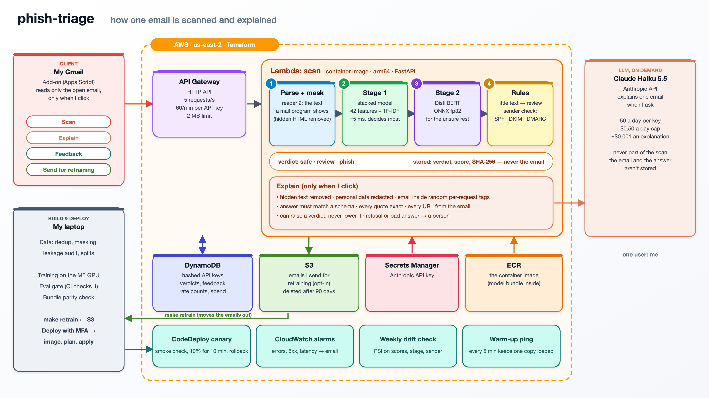

# phish-triage

[](https://github.com/vipin-mo/phish-triage/actions/workflows/ci.yml)

phish-triage scores emails for phishing and explains why. It runs on AWS Lambda behind an API, and I use it from a
Gmail add-on on my own mail.

It grew out of my course project, where a simple model scored about 98% precision and recall, but its
explanations showed it was leaning on dataset artifacts: names like `enron` and years like `2004`, not
phishing signals. This project measures how much those artifacts and duplicate emails inflated that
score, and is built to catch the shortcuts that fooled the course project:

- **An evaluation built against shortcuts:** duplicates removed, a dataset-leakage audit, tests on a different
  source, on newer phishing, on a test inbox and on newsletters, and recall reported at a fixed false-alarm rate.
  It still let some through, which I found later; they are under [Known issues](docs/FINDINGS.md#known-issues).
- **A two-stage cascade:** a stacked model (trees on features plus a text score; about 5 ms an email on my laptop)
  and a fine-tuned DistilBERT for what the first isn't sure of. In the model in service the first decides 92–93% of
  the public and 2026 test emails; DistilBERT decides 60% of my test inbox and 19% of the held-out newsletters. A
  third stage, Claude, was measured too; on a 1,000-email sample no email was uncertain enough to reach it.
- **A safe LLM step:** explanations on demand from Claude, grounded, schema-checked, able to raise risk but never
  lower it, and tested against prompt injection hidden inside phishing emails.
- **Sender checks:** SPF, DKIM and DMARC results from the receiving mail provider, look-alike domains,
  and mismatched display names, From and Reply-To addresses, shown to me and to the analyst. The rule-based sender
  verdict doesn't change the cascade's; stage 1 has the same header signals as features, and refitted without them
  it decides the same.
- **Tested against evasion:** hidden HTML, look-alike letters, invisible characters, shortened links and
  LLM-written phishing, with a defence measured before it was deployed.
- **Real use, serverless:** a Gmail sidebar add-on (one user: me), AWS Lambda + API Gateway + DynamoDB in
  Terraform, canary rollout of new models, a weekly drift check, and retraining from emails I send.

**Built with** Python 3.12, scikit-learn, PyTorch and Hugging Face Transformers (training only), ONNX Runtime,
FastAPI, the Claude API, AWS (Lambda, API Gateway, DynamoDB, S3, Secrets Manager, CodeDeploy, CloudWatch),
Terraform, Docker, GitHub Actions and Google Apps Script.

## Results

The model in service (`with-visible-20261112-ac59a4e3`, since 2026-11-12; its [model card](docs/MODEL_CARD.md)), on
test emails it never trained on ([reports/with_inbox.md](reports/with_inbox.md), *visible*;
[reports/defence.md](reports/defence.md), setup e, the bundle in service), with Wilson 95% intervals (the reports
give bootstrap ones, which differ by about a point):

| Test | Result | 95% interval |
|---|---:|---:|
| Public test phishing (Nazario, phishing_pot; 1,401 emails) | 97.8% caught | 96.9–98.4% |
| Public test legitimate mail (Apache lists; 1,401) | 3 flagged (0.2%) | 0.1–0.6% |
| 2026 phishing (phishing_pot, the same months as training; 1,644) | 98.3% caught | 97.5–98.8% |
| Phishing three months newer than training (a candidate trained on phishing up to July 2026; 354 October emails) | 83.1% caught (98.2% in August) | 78.8–86.6% |
| Phishing that looks like a newsletter (31) | 23 caught (74%) | 57–86% |
| My test inbox (a Gmail account I subscribed to newsletters and shops), 26 senders held out of training (249 emails; 2 of the senders share a domain with training, [DATA.md](docs/DATA.md)) | 4 flagged (1.6%; 5.8% averaged per sender) | 0.6–4.1% |
| My test inbox's later mail from those 26 senders, which no model was chosen on (154 emails from 17 of them) | 6 flagged (3.9%) | 1.8–8.2% |
| Newsletters from 189 websites held out of training (PrivacyMail; 3,738) | 48 flagged (1.3%), 83 (2.2%) with the ones sent to review | 1.0–1.7% |
| LLM-written phishing (Greco et al., written with WormGPT; 1,000) | 94.0% caught | 92.4–95.3% |
| Public test phishing with text hidden by the three tricks reader 2 has rules for | 96.2–97.8% caught (16.9% before the defence) | |
| ... hidden with `text-indent`, `clip` or `transform` (held out until reader 3 got rules for them) | 97.8% caught (6.9% with reader 2) | 96.9–98.4% |
| ... hidden six new ways reader 3 has no rule for (held out since 2026-11-13: `@media` rules, off-screen to the right, a 1 px box, `color:transparent`, `filter:opacity(0)`, an empty `clip-path`) | 7.3% caught | 6.0–8.8% |
| My real Gmail, from the add-on (78 emails scanned by the model in service, 45 more by an older one) | 14 flagged by the model in service; I marked 10 of them false alarms and none correct | |
| Precision if 1 email in 100 were phishing (recall as above, false alarms as on my test inbox) | 0.38 | 0.19–0.61 |

Four caveats:

- **The tests were used to choose the model.** I scored these same sets for every model I compared, and picked
  the one in service on them, so they are closer to validation numbers than to a fresh test. Differences of a few
  emails between models are within the noise of one training run. The one untouched test is my inbox's later mail
  from its held-out senders ([reports/fresh_inbox.md](reports/fresh_inbox.md)): 3.9% flagged, against 1.6% on
  the emails the model was chosen on; the intervals overlap, and with it the precision row would be 0.20.
- **The test inbox is bulk mail,** mostly notifications, newsletters and shops, not personal mail. My real mail
  is the second-to-last row: 123 emails I chose to scan, too few and too hand-picked for a rate, but its false
  alarms are far more than the test inbox predicts.
- **The legitimate labels weren't checked by hand.** My inbox's emails count as legitimate because Gmail delivered
  them outside Spam, and PrivacyMail's because the dataset is newsletters: a phishing email among them would count
  as a false alarm when flagged and as legitimate when missed.
- **The 2026 phishing comes from the same honeypot and months as training,** and the public test's legitimate
  side is mailing-list discussion, which text alone tells apart. Phishing from months the model hasn't seen gets
  through more often: the October row is a separate model trained the same way on phishing up to July. The
  precision row is why a flag here means "look closer", not "delete".

### The course project, rebuilt

The course model (TF-IDF + logistic regression) on its own data and on this project's
([reports/course_reproduction.md](reports/course_reproduction.md), [reports/baselines.md](reports/baselines.md)):

| | Course model | This project |
|---|---|---|
| Its own random split | 98.4% precision, 98.9% recall (reproduced) | |
| The same, duplicates removed | 98.1% precision, 99.0% recall | |
| A source it never saw (train on five, test on the sixth) | 7–24% false alarms; 51% of Nazario's phishing caught | |
| 2023–2026 phishing, at 1% false alarms | 82.3% caught | 99.0% (text model) |
| The same, the course model trained on this project's emails | 98.4% caught | |

Duplicates barely mattered. The sources did: 88% of the course data's "phishing" label was spam (30,366 of the
34,667 rows, from CEAS, Enron, Ling and SpamAssassin; Nazario's phishing is 4%), and each source's style gave the
label away, so the score fell apart on a source the model hadn't seen. The last two rows show the gap is mostly
the data: trained on this project's emails, the course's own model catches 98.4%. Recall at 1% false alarms is
read off the test set's curve here, to compare models; the service runs at thresholds chosen on validation.

### How much LLM is needed

On a fixed 1,000-email sample of the public test (500 phishing, 500 legitimate), with the public-data models
([docs/RESULTS.md](docs/RESULTS.md)):

| Setup | Recall | False alarms | Decided by stage 1 / DistilBERT / Claude | Sent to a third party | Cost at 1M emails a day | Latency |
|---|---:|---:|---|---:|---:|---:|
| Stacked model only | 99.8% | 1.80% | 100% / 0% / 0% | 0% | $0 | 5 ms |
| DistilBERT only (ONNX int8; the service runs fp32) | 100.0% | 0.80% | 0% / 100% / 0% | 0% | $0 | 29 ms |
| Cascade: stacked → DistilBERT → Claude | 99.6% | 0.00% | 99.7% / 0.3% / 0% | 0% | $0 | 6 ms |
| Claude Haiku 5.5 on every email | 97.4% | 0.80% | 0% / 0% / 100% | 100% | $167 a day | 1.5 s |
| Claude Haiku 5.5 with 4 examples, on every email | 96.6% | 0.20% | 0% / 0% / 100% | 100% | $187 a day | 1.5 s |

On this test Claude was no more accurate than the local models, and it costs money and sends every email to a
third party, so the service decides with the local models and uses Claude only to explain, when I ask. This is the
public test, where the text alone separates the classes, and Claude read each email's plain-text part while the
local models read its visible HTML, so it doesn't show whether an LLM would help on harder mail.

### The LLM step under attack

The analyst sees the email, our signals and the classifier's verdict, and can raise the verdict but never lower
it ([reports/analyst.md](reports/analyst.md), [reports/injection.md](reports/injection.md),
[reports/injection_round2.md](reports/injection_round2.md)):

- **Prompt injection:** 40 phishing emails, each with an instruction planted nine ways (visible and hidden text,
  a comment, alt text, the subject, a forged signals block, fake operator and IT-test notices): with the
  defences, 0 of the 360 ended as safe. Without them Claude's own answer said safe once in 360, but about half of
  those answers didn't match the schema at all (188 of 360), so this shows the pipeline holds, not how much each
  defence adds. The verdict here is the explanation's: a plain scan is the classifier's alone. The forged signals
  block un-flagged the reader-2 classifier on 1 of the 40; reader 3 drops it, and the classifier un-flags none
  ([Known issues](docs/FINDINGS.md#known-issues)).
- **Ordinary mail:** 100% schema-valid answers; 0.6% of indicators dropped as ungrounded; it raised the one
  phishing email of 100 the classifier missed to "suspicious", and 7 of the 100 legitimate (mailing-list) emails
  too; the one legitimate email the classifier flagged stayed "phish", since it can't lower a verdict.

### Robustness, load and explanations

- **Evasion** ([reports/robustness.md](reports/robustness.md), [reports/defence.md](reports/defence.md)): hidden
  HTML text dropped the old model to 16.9%. A better reader (reader 2) and retraining brought it to 96.1–97.7% for
  the three tricks the reader has rules for, and LLM-written phishing from 88.8% to 94.0% (one training run each;
  across the setups I tried, LLM-written phishing ranged from 84.1% to 94.0%). Text hidden with
  `text-indent`, `clip` or `transform`, which reader 2 had no rule for, got through: 6.9%. Reader 3 (in service
  since 2026-11-12) has rules for them, and catches 97.8%. Six new tricks held out since, which it has no rule
  for, get through as before: 7.3%. The reader catches the tricks it was written for, not hiding in general.
- **Load** ([reports/load_test.md](reports/load_test.md)): 543 requests of one short test email at up to 10 a
  second, a test of the rate limits rather than of real load. The limits refused the excess, nothing failed, and an
  answered scan took 45 ms at the gateway (p50); a real email takes about 0.2 s end to end.
- **Explanations** ([reports/explanations.md](reports/explanations.md)): the words LIME and Integrated Gradients
  rank highest move the score 4–25 times more than random words, but for most flagged emails no handful of words
  decides the verdict: removing the top 10 drops 12–25% of them to the threshold (0.3–7% for random words). The
  explanations I read in the add-on are Claude's, and they aren't tested this way.
- **Newer phishing** ([reports/time_split.md](reports/time_split.md)): a candidate trained as the deployed model is,
  but with every phishing email from August 2026 on taken out of training, caught 98.2% of the earlier months' test
  phishing, 98.2% of August's, 95.5% of September's and 83.1% of October's. It ages within months, so new phishing
  has to keep reaching training, and today that takes a new pull of public phishing and a full retrain: the add-on
  can't run on Spam, where most phishing lands, and `make retrain` refits stage 1 only. Its false alarms differ too
  (8 of my inbox's 249 test emails against the deployed model's 4, 17 PrivacyMail newsletters against 51), so it
  sits at a different trade-off, not only an older one.
- **Sender features** ([reports/sender_ablation.md](reports/sender_ablation.md)): stage 1 refitted without the 11
  header features (sender domain, display name, Reply-To, DKIM and the rest) catches and flags the same emails,
  except 2 of the 1,644 2026 phishing emails. Detection doesn't rest on them; without them stage 1 is sure of fewer
  emails and passes 1–9 points more to DistilBERT.
- **Real use** ([reports/real_use.md](reports/real_use.md)): 123 of my own emails scanned from the add-on by
  2026-11-12, 78 of them by the model in service. It flagged 14 of those 78, and I marked 10 of the 14 as false
  alarms (none as correct, no phishing missed). All 10 were DistilBERT's calls, so `make retrain`, which refits stage
  1 only, can't fix them; the next model update retrains both stages with the 19 emails I've sent since.
- **The drift check's first reading** (the week to 2026-11-08, 48 scans) alarmed on all three distributions: PSI
  2.29 on the scores, 1.09 on the deciding stage and 2.86 on the sender check, against a limit of 0.25. Measured
  against my test inbox alone instead of the inbox and PrivacyMail together, the stage (0.17) and the sender check
  (0.03) fit, and the scores still don't (1.42): half of my real scans land in the less-safe bins, against a tenth of
  the test inbox's. Since 2026-11-12 the reference is the test inbox alone; the score alarm stays.

## Demo


The add-on on a real email in my Gmail, sped up where it waits for Claude (25 s). It is one of the false alarms in
[Known issues](docs/FINDINGS.md#known-issues): a genuine Xfinity notice the model flags at 0.9993. Claude's explanation keeps the
verdict (it can raise one, never lower it) and points at what looks wrong, links that go through Adobe's tracking
domain instead of xfinity.com, without calling the email phishing. I mark it a false alarm and send it for
retraining as legitimate. The member-tier badge is blurred.

## Architecture



([SVG source](docs/architecture.svg))

The service stores no email, only a verdict, a score and the email's SHA-256, unless I send one for retraining
([docs/THREAT_MODEL.md](docs/THREAT_MODEL.md)). The Anthropic key sits in Secrets Manager, and explanations stop
at 50 a day per key and $0.50 a day in all.

The service's CloudWatch dashboard from 2026-11-04 00:00 to 2026-11-05 18:00 UTC, each panel rendered by CloudWatch
(`make dashboard-images`), so no account details are in the pictures:

| | |
|---|---|
|  |  |
|  |  |

- **The spikes just after midnight on 2026-11-05 are the load tests** ([reports/load_test.md](reports/load_test.md)):
  most of the requests were refused with 429 by the rate limits (the 4xx line), and the function had no errors.
- **The scan time's p95 spikes are copies loading the model:** about 20 s on a cold start and up to 100 s the
  first time a new image runs, while the average stays low.
- **The API's p95 reached 29 s once,** on the morning of 2026-11-04: a new model's first load took 60 s, and six
  requests waiting on it got API Gateway's 29 s timeout (503). The deploy now loads the model before it finishes.

## Cost

Measured in AWS Cost Explorer for 2026-10-29 to 2026-11-05 (November's figures are still estimates), and from the
spend ledger my Claude runs write:

| What | Cost |
|---|---:|
| ECR, the container images | $0.010 |
| Secrets Manager, the Anthropic key | $0.006 |
| S3: Terraform state, model bundles, emails sent for retraining | $0.002 |
| DynamoDB | $0.002 |
| API Gateway | $0.002 |
| Lambda, CloudWatch, KMS, SNS, Budgets | $0.000 (inside the free tier) |
| **This project on AWS, eight days** | **$0.02**, paid from the Free plan's credits |
| Claude, every evaluation in this README (Haiku 5.5, and Sonnet 5.5 on 200 emails in Phase 3) | $3.50 |

A live explanation costs about $0.001. Most of the money went to measuring, not running. Keeping the service up
costs about $1 a month at AWS's list prices, nearly all of it storage: about $0.60 for the last 10 container images
and $0.40 for the secret; my scans fit in the free tier. (The account's total also has $0.69 of disk storage from
outside this project.)

## Limits

- **Few sources, one person's mail.** Two public phishing sources and one public legitimate one (Apache mailing
  lists); a second legitimate source I planned (the Linux kernel lists) isn't added. My test inbox and PrivacyMail
  stand in for real mail, both mostly bulk mail, and the real-use numbers are one person's few days.
- **My real mail gets more false alarms than the tests show:** 10 of the 14 emails the model in service flagged.
- **The tests chose the model** (above): the reported numbers are closer to validation than to a fresh test.
- **It ages within months:** trained on phishing up to July, a candidate caught 83.1% of October's.
- **Newsletter-like phishing:** 23 of 31 caught. Few public phishing emails look like that, so there is little to
  learn from.
- **Big brands asking me to act read as phishing.** A rule sending own-domain-signed mail to review moved as many
  phishing emails as false alarms, so it isn't used.
- **Hidden text is caught trick by trick.** Reader 3 catches the tricks it has rules for (97.8%), but six new ones
  it has no rule for drop recall to 7.3%: a hidden paragraph that fills DistilBERT's 512 tokens still decides it.
- **Images aren't read:** an image-only or QR-code email is judged on its few words (it goes to review when it has
  almost none).
- **The AWS Free plan** blocks keyless CI deploys, so I deploy from my laptop with MFA, and the account closes on
  2027-04-27 unless I upgrade.

The full list, with what was fixed, is under [Known issues](docs/FINDINGS.md#known-issues).

## The details

- [What I found, in order](docs/FINDINGS.md): the data, the baselines, DistilBERT and Claude, the analyst step, my
  test inbox, PrivacyMail, the deployment, the attacks and the explanation check, then every
  [known issue](docs/FINDINGS.md#known-issues) and [what changed from the plan](docs/FINDINGS.md#changed-from-the-plan).
- The [model card](docs/MODEL_CARD.md), the [threat model](docs/THREAT_MODEL.md), the [data card](docs/DATA.md), the
  [features](docs/FEATURES.md) and the [Phase 3 results](docs/RESULTS.md).
- [reports/](reports/): every measurement behind these numbers.

## How I built it

The problem and the goals were mine. In my course project I trained standard models on a public dataset; they
scored about 98%, and their explanations showed why that number couldn't be trusted, so I set out to rebuild it
with an evaluation that shortcuts can't pass so easily. The design choices were mine too: local models decide and
an LLM only explains and can never lower a verdict, the service keeps no email, it runs serverless on AWS, and LLM
spend has hard caps.

Most of the code was written by an AI coding assistant (Claude Code), working from my plans and decisions. The two
reviews in [Known issues](docs/FINDINGS.md#known-issues) were audits I ran with AI agents over the code, the
numbers and the claims. When they found a problem I didn't patch around it: I asked what the better fix was, and
what each one found and what changed is listed there.

## Progress

- [x] **Phase 0** — repo, CI, [threat model](docs/THREAT_MODEL.md)
- [x] **Phase 1** — data you can trust: [sources and data card](docs/DATA.md), de-duplication, [leakage audit](reports/leakage_audit.md), splits
- [x] **Phase 2** — [features and sender check](docs/FEATURES.md), [baseline models](reports/baselines.md), metrics module, [course reproduction](reports/course_reproduction.md)
- [x] **Phase 3** — DistilBERT ([ONNX int8](reports/onnx.md)), LLM comparison, cascade ([results](docs/RESULTS.md))
- [x] **Phase 4** — grounded LLM analyst step ([results](reports/analyst.md)), prompt-injection tests ([round 1](reports/injection.md), [round 2](reports/injection_round2.md)), CI eval gate
- [x] **Phase 5** — serverless AWS deployment: [service and bundle](reports/bundle.md), Lambda + API Gateway + DynamoDB in [Terraform](infra/), deployed from my laptop with MFA (OIDC CI/CD blocked by the Free plan), [measured cost](#cost), [dashboard](#architecture)
- [x] **Phase 6** — explanations on demand, [Gmail add-on](addon/) (in use), canary and shadow mode, weekly drift check, retraining from emails I send, [real use](reports/real_use.md)
- [x] **Phase 7** — [load test](reports/load_test.md), [robustness report](reports/robustness.md), [defence](reports/defence.md) (deployed), [explanation check](reports/explanations.md), [write-up](#results), [model card](docs/MODEL_CARD.md)

## Development

Requires [uv](https://docs.astral.sh/uv/), Python 3.12 and, for the commit hook, [gitleaks](https://github.com/gitleaks/gitleaks).

```bash
make setup   # create .venv, install dev deps, install git hooks
make check   # lint, the raw-data and secret checks, the 273 tests, the eval gate (what CI runs)
```

Raw email datasets are never committed. A pre-commit hook and a CI check block mail, archive, dataset and model
files (`.eml`, `.mbox`, `.jsonl`, `.onnx`, `.joblib`, ...), anything under `data/`, `artifacts/` or `build/`, any
file over 1 MB (bar the lock file and the 1.2 MB demo GIF) and any file that starts like an email; CI also checks
every version of every path in the history, so one added and then deleted can't stay there. Secrets, keys and
Terraform state, variables and plans are blocked by name, and gitleaks looks for secrets, account IDs, API
addresses, API keys and personal addresses in each commit (a pre-commit hook) and in the whole history (CI).
Instead, `make data` downloads every source, checks it against pinned checksums,
parses it into one record format, masks source fingerprints, removes duplicates and builds every split with
fixed seeds (see [docs/DATA.md](docs/DATA.md)). `make audit` re-runs the leakage audit, `make eval-baselines`
trains and reports the baseline models on every split, `make eval-course` reproduces the course project's
score, `make train-transformer` fine-tunes DistilBERT (needs `uv sync --group train`), and `make eval` rebuilds
[docs/RESULTS.md](docs/RESULTS.md) from saved predictions. `make eval-analyst` and `make eval-injection` show
their Claude cost and only call the API with `CONFIRM=--confirm`; `make gate` turns their results into
[reports/gate.json](reports/gate.json), which CI checks without calling any API. `make parse-timings` times the
parsing fixes against the code they replaced ([reports/parse_timings.md](reports/parse_timings.md)).

`make bundle` packages the deployed model and checks it against its report, and `make serve` runs the API locally
on it. Deploying needs an MFA session (`aws sts get-caller-identity --profile phish-triage`) and Docker:
`infra/bootstrap.sh` (once) creates the state bucket, and `make tf-foundation-plan` / `tf-foundation-apply` the
image registry and the model bucket; then `make upload-bundle`, `make deploy-image`, `make deploy-plan` (shows the change) and
`make deploy-apply` (applies exactly that plan, loads the model and checks `/v1/health`). `make api-key OWNER=...`
creates a key, shown once.

## License

MIT. Datasets keep their own licenses, documented in [docs/DATA.md](docs/DATA.md).
