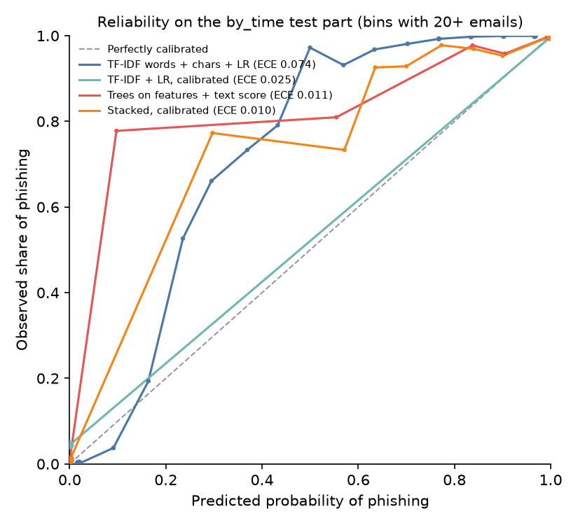

# Baseline models

Generated by `make eval-baselines`. Each model is trained on a split's `train` part; its threshold is chosen on `val` for a 1% false-alarm rate and then applied unchanged to `test`. Brackets are 95% bootstrap intervals (1000 class-stratified resamples).

- **Recall @ 1% / 0.1% FPR:** share of phishing caught while flagging at most 1% / 0.1% of legitimate mail, read off the test ROC curve.
- **Test FPR:** the false-alarm rate the validation threshold really gives on test.
- **Precision @ 1 in 100:** precision at that threshold if 1 email in 100 were phishing.
- **Calibrated rows** change only the probabilities (ECE). Their ranking, and so every other column, matches the uncalibrated model, because isotonic ties are broken by the uncalibrated score.

## `random` (1,401 phishing / 1,401 legitimate in test)

| Model | PR-AUC | Recall @ 1% FPR | Recall @ 0.1% FPR | Test FPR | Precision @ 1 in 100 | ECE |
|---|---|---|---|---|---|---|
| Course setup (word TF-IDF + LR) | 1.000 (0.999–1.000) | 0.998 (0.991–1.000) | 0.889 (0.687–0.989) | 1.64% (1.00%–2.28%) | 0.381 (0.306–0.502) | 0.042 (0.040–0.045) |
| TF-IDF words + chars + LR | 1.000 (1.000–1.000) | 0.999 (0.996–1.000) | 0.986 (0.977–0.999) | 1.93% (1.21%–2.64%) | 0.344 (0.277–0.454) | 0.015 (0.014–0.017) |
| Trees on structured features | 0.999 (0.998–0.999) | 0.968 (0.952–0.983) | 0.870 (0.784–0.936) | 1.50% (0.93%–2.14%) | 0.397 (0.314–0.516) | 0.007 (0.006–0.013) |
| Trees on features + text score | 1.000 (1.000–1.000) | 0.999 (0.996–1.000) | 0.994 (0.967–0.999) | 1.86% (1.21%–2.57%) | 0.352 (0.282–0.454) | 0.003 (0.002–0.005) |
| TF-IDF + LR, calibrated | 1.000 (1.000–1.000) | 0.999 (0.996–1.000) | 0.986 (0.977–0.999) | 1.93% (1.21%–2.64%) | 0.344 (0.277–0.454) | 0.003 (0.002–0.005) |
| Stacked, calibrated | 1.000 (1.000–1.000) | 0.999 (0.996–1.000) | 0.994 (0.967–0.999) | 1.86% (1.21%–2.57%) | 0.352 (0.282–0.454) | 0.001 (0.000–0.003) |

## `by_source/nazario_to_phishing_pot` (6,552 phishing / 6,552 legitimate in test)

| Model | PR-AUC | Recall @ 1% FPR | Recall @ 0.1% FPR | Test FPR | Precision @ 1 in 100 | ECE |
|---|---|---|---|---|---|---|
| Course setup (word TF-IDF + LR) | 0.997 (0.996–0.998) | 0.982 (0.967–0.988) | 0.516 (0.256–0.686) | 1.25% (1.01%–1.53%) | 0.444 (0.395–0.498) | 0.159 (0.156–0.161) |
| TF-IDF words + chars + LR | 0.998 (0.997–0.999) | 0.987 (0.981–0.992) | 0.640 (0.416–0.902) | 1.04% (0.82%–1.30%) | 0.490 (0.435–0.548) | 0.088 (0.086–0.090) |
| Trees on structured features | 0.962 (0.960–0.965) | 0.744 (0.712–0.761) | 0.515 (0.324–0.571) | 0.79% (0.59%–1.01%) | 0.477 (0.417–0.551) | 0.122 (0.118–0.127) |
| Trees on features + text score | 0.998 (0.997–0.999) | 0.992 (0.989–0.994) | 0.817 (0.526–0.948) | 0.75% (0.55%–0.95%) | 0.572 (0.513–0.646) | 0.017 (0.015–0.019) |
| TF-IDF + LR, calibrated | 0.998 (0.997–0.999) | 0.987 (0.981–0.992) | 0.640 (0.416–0.902) | 1.04% (0.82%–1.30%) | 0.490 (0.435–0.548) | 0.017 (0.015–0.019) |
| Stacked, calibrated | 0.998 (0.997–0.999) | 0.992 (0.989–0.994) | 0.817 (0.526–0.948) | 0.75% (0.55%–0.95%) | 0.572 (0.513–0.646) | 0.010 (0.008–0.012) |

## `by_source/phishing_pot_to_nazario` (2,786 phishing / 2,786 legitimate in test)

| Model | PR-AUC | Recall @ 1% FPR | Recall @ 0.1% FPR | Test FPR | Precision @ 1 in 100 | ECE |
|---|---|---|---|---|---|---|
| Course setup (word TF-IDF + LR) | 0.999 (0.999–1.000) | 0.995 (0.987–0.999) | 0.829 (0.564–0.956) | 2.51% (2.01%–3.09%) | 0.286 (0.246–0.334) | 0.075 (0.073–0.078) |
| TF-IDF words + chars + LR | 1.000 (1.000–1.000) | 0.997 (0.991–0.999) | 0.948 (0.811–0.981) | 2.94% (2.33%–3.52%) | 0.256 (0.223–0.302) | 0.030 (0.028–0.032) |
| Trees on structured features | 0.991 (0.989–0.993) | 0.800 (0.760–0.859) | 0.325 (0.262–0.504) | 4.99% (4.16%–5.85%) | 0.165 (0.144–0.191) | 0.015 (0.012–0.020) |
| Trees on features + text score | 1.000 (1.000–1.000) | 0.999 (0.995–1.000) | 0.983 (0.927–0.994) | 2.30% (1.76%–2.84%) | 0.305 (0.263–0.365) | 0.003 (0.003–0.005) |
| TF-IDF + LR, calibrated | 1.000 (1.000–1.000) | 0.997 (0.991–0.999) | 0.948 (0.811–0.981) | 2.94% (2.33%–3.52%) | 0.256 (0.223–0.302) | 0.005 (0.004–0.007) |
| Stacked, calibrated | 1.000 (1.000–1.000) | 0.999 (0.995–1.000) | 0.983 (0.927–0.994) | 2.30% (1.76%–2.84%) | 0.305 (0.263–0.365) | 0.005 (0.003–0.007) |

## `by_time` (7,445 phishing / 7,445 legitimate in test)

| Model | PR-AUC | Recall @ 1% FPR | Recall @ 0.1% FPR | Test FPR | Precision @ 1 in 100 | ECE |
|---|---|---|---|---|---|---|
| Course setup (word TF-IDF + LR) | 0.998 (0.998–0.999) | 0.987 (0.983–0.991) | 0.654 (0.534–0.781) | 0.73% (0.54%–0.93%) | 0.577 (0.516–0.647) | 0.148 (0.146–0.150) |
| TF-IDF words + chars + LR | 0.999 (0.998–0.999) | 0.988 (0.983–0.992) | 0.851 (0.642–0.923) | 1.53% (1.25%–1.80%) | 0.396 (0.358–0.446) | 0.074 (0.073–0.076) |
| Trees on structured features | 0.955 (0.952–0.958) | 0.750 (0.737–0.768) | 0.544 (0.429–0.656) | 0.34% (0.21%–0.47%) | 0.676 (0.600–0.765) | 0.108 (0.104–0.113) |
| Trees on features + text score | 0.999 (0.998–0.999) | 0.994 (0.992–0.996) | 0.926 (0.718–0.960) | 0.82% (0.62%–1.03%) | 0.551 (0.493–0.619) | 0.011 (0.010–0.013) |
| TF-IDF + LR, calibrated | 0.999 (0.998–0.999) | 0.988 (0.983–0.992) | 0.851 (0.642–0.923) | 1.53% (1.25%–1.80%) | 0.396 (0.358–0.446) | 0.025 (0.022–0.027) |
| Stacked, calibrated | 0.999 (0.998–0.999) | 0.994 (0.992–0.996) | 0.926 (0.718–0.960) | 0.82% (0.62%–1.03%) | 0.551 (0.493–0.619) | 0.010 (0.009–0.012) |

## `by_time_nazario` (1,342 phishing / 1,342 legitimate in test)

| Model | PR-AUC | Recall @ 1% FPR | Recall @ 0.1% FPR | Test FPR | Precision @ 1 in 100 | ECE |
|---|---|---|---|---|---|---|
| Course setup (word TF-IDF + LR) | 1.000 (0.999–1.000) | 0.998 (0.990–1.000) | 0.920 (0.880–0.985) | 0.37% (0.07%–0.75%) | 0.727 (0.571–0.930) | 0.112 (0.109–0.116) |
| TF-IDF words + chars + LR | 1.000 (0.999–1.000) | 0.993 (0.987–0.997) | 0.949 (0.939–0.990) | 0.30% (0.07%–0.60%) | 0.770 (0.625–0.931) | 0.042 (0.040–0.046) |
| Trees on structured features | 0.997 (0.995–0.998) | 0.930 (0.865–0.955) | 0.797 (0.580–0.844) | 0.89% (0.37%–1.34%) | 0.507 (0.404–0.708) | 0.025 (0.020–0.032) |
| Trees on features + text score | 1.000 (0.999–1.000) | 0.996 (0.990–0.999) | 0.927 (0.833–0.992) | 0.52% (0.15%–0.97%) | 0.658 (0.509–0.871) | 0.008 (0.005–0.012) |
| TF-IDF + LR, calibrated | 1.000 (0.999–1.000) | 0.993 (0.987–0.997) | 0.949 (0.939–0.990) | 0.30% (0.07%–0.60%) | 0.770 (0.625–0.931) | 0.012 (0.009–0.017) |
| Stacked, calibrated | 1.000 (0.999–1.000) | 0.996 (0.990–0.999) | 0.927 (0.833–0.992) | 0.52% (0.15%–0.97%) | 0.658 (0.509–0.871) | 0.008 (0.006–0.012) |

## `old_era` (666 phishing / 611 legitimate in test)

| Model | PR-AUC | Recall @ 1% FPR | Recall @ 0.1% FPR | Test FPR | Precision @ 1 in 100 | ECE |
|---|---|---|---|---|---|---|
| Course setup (word TF-IDF + LR) | 0.999 (0.998–1.000) | 0.988 (0.979–0.995) | 0.958 (0.944–0.991) | 0.49% (0.00%–1.15%) | 0.669 (0.465–1.000) | 0.067 (0.061–0.073) |
| TF-IDF words + chars + LR | 1.000 (0.999–1.000) | 0.994 (0.988–0.998) | 0.988 (0.980–0.998) | 0.16% (0.00%–0.49%) | 0.859 (0.669–1.000) | 0.024 (0.021–0.029) |
| Trees on structured features | 0.999 (0.999–1.000) | 0.982 (0.967–0.995) | 0.970 (0.956–0.983) | 1.15% (0.49%–1.96%) | 0.465 (0.335–0.671) | 0.011 (0.008–0.017) |
| Trees on features + text score | 1.000 (0.999–1.000) | 0.995 (0.989–1.000) | 0.991 (0.985–0.998) | 1.64% (0.65%–2.78%) | 0.381 (0.266–0.605) | 0.004 (0.001–0.008) |
| TF-IDF + LR, calibrated | 1.000 (0.999–1.000) | 0.994 (0.988–0.998) | 0.988 (0.980–0.998) | 0.16% (0.00%–0.49%) | 0.859 (0.669–1.000) | 0.007 (0.004–0.012) |
| Stacked, calibrated | 1.000 (0.999–1.000) | 0.995 (0.989–1.000) | 0.991 (0.985–0.998) | 1.64% (0.65%–2.78%) | 0.381 (0.266–0.605) | 0.003 (0.001–0.007) |

## Spam flagged as phishing (models trained on `random`, at their 1% thresholds)

| Model | Share of spam flagged |
|---|---:|
| Course setup (word TF-IDF + LR) | 99.3% |
| TF-IDF words + chars + LR | 99.9% |
| Trees on structured features | 52.2% |
| Trees on features + text score | 99.9% |
| TF-IDF + LR, calibrated | 99.9% |
| Stacked, calibrated | 99.9% |

## Each structured feature on its own (test ROC AUC, no training)

Above 0.5: higher values lean phishing. A feature that separates `random` but not the cross-source tests is learning the dataset, not phishing.

| Feature | `random` | `by_source/nazario_to_phishing_pot` | `by_source/phishing_pot_to_nazario` |
|---|---:|---:|---:|
| `from_missing` | 0.540 | 0.553 | 0.507 |
| `from_free_mail` | 0.418 | 0.451 | 0.371 |
| `from_log_rank` | 0.756 | 0.764 | 0.689 |
| `from_lookalike` | 0.499 | 0.499 | 0.495 |
| `display_name_brand_mismatch` | 0.554 | 0.529 | 0.601 |
| `display_name_has_other_address` | 0.506 | 0.505 | 0.506 |
| `reply_to_differs` | 0.537 | 0.543 | 0.520 |
| `reply_to_free_mail_differs` | 0.511 | 0.515 | 0.510 |
| `to_missing` | 0.549 | 0.552 | 0.540 |
| `dkim_signed` | 0.493 | 0.519 | 0.450 |
| `dkim_aligned` | 0.418 | 0.409 | 0.469 |
| `n_urls` | 0.493 | 0.478 | 0.545 |
| `n_link_domains` | 0.475 | 0.426 | 0.577 |
| `ip_url` | 0.498 | 0.500 | 0.492 |
| `punycode_url` | 0.501 | 0.500 | 0.501 |
| `confusable_url` | 0.501 | 0.500 | 0.501 |
| `lookalike_url` | 0.510 | 0.513 | 0.509 |
| `shortener_url` | 0.539 | 0.545 | 0.523 |
| `url_with_credentials` | 0.502 | 0.504 | 0.502 |
| `http_share` | 0.587 | 0.593 | 0.572 |
| `max_url_length` | 0.632 | 0.603 | 0.712 |
| `max_subdomain_depth` | 0.520 | 0.473 | 0.620 |
| `link_text_mismatch` | 0.535 | 0.527 | 0.549 |
| `brand_mentioned_not_linked` | 0.519 | 0.502 | 0.554 |
| `max_link_log_rank` | 0.667 | 0.631 | 0.736 |
| `unranked_link_share` | 0.673 | 0.668 | 0.681 |
| `has_html` | 0.892 | 0.912 | 0.828 |
| `html_form` | 0.503 | 0.503 | 0.501 |
| `password_input` |  |  |  |
| `html_script` | 0.507 | 0.507 | 0.505 |
| `n_images` | 0.757 | 0.773 | 0.702 |
| `n_attachments` | 0.546 | 0.524 | 0.574 |
| `risky_attachment` | 0.512 | 0.501 | 0.532 |
| `html_attachment` | 0.511 | 0.500 | 0.529 |
| `archive_attachment` | 0.501 | 0.500 | 0.503 |
| `macro_attachment` |  |  |  |
| `log_words` | 0.256 | 0.289 | 0.159 |
| `urgency_terms` | 0.564 | 0.524 | 0.647 |
| `credential_terms` | 0.554 | 0.499 | 0.689 |
| `payment_terms` | 0.611 | 0.615 | 0.593 |
| `exclamations` | 0.594 | 0.644 | 0.464 |
| `recipient_address_in_body` | 0.579 | 0.562 | 0.640 |
